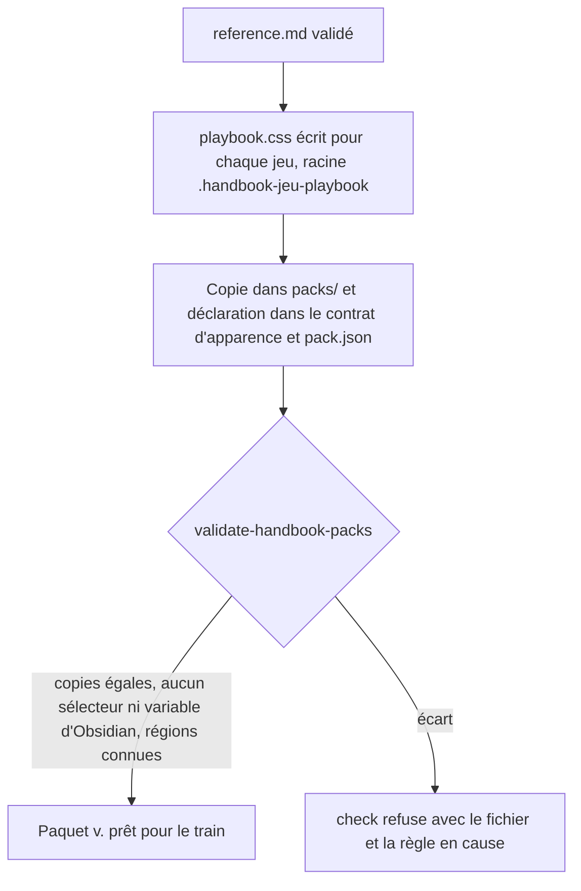
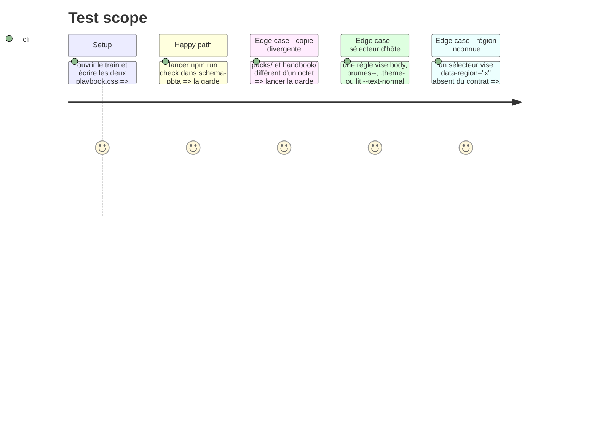

# Instruction: Publier le CSS de playbook host-neutral dans schema-pbta

## Architecture projection

> Tree of the final files. ✅ create · ✏️ modify · ❌ delete

```txt
../obsidian-handbook/
└── supervisor/trains/pbta-playbook-shared-styles.json ✅ écrit par `pnpm supervise open`, avec l'issue de coordination ; lantern#76 rattachée
../schema-pbta/
├── handbook/monsterhearts/assets/styles/playbook.css ✅ habillage du bloc playbook, repris de `obsidian-handbook/src/styles/pbta/_blocks.scss` (l. 63-291), re-scopé sur `.handbook-monsterhearts-playbook` et corrigé d'après reference.md
├── packs/monsterhearts/assets/styles/playbook.css ✅ copie octet pour octet du précédent, publiée dans le paquet
├── handbook/monsterhearts/pack.json ✏️ `assets.stylesheets` ajoute `styles/playbook.css` ; `minimumHandbookVersion` monte à la version Handbook du train ; version du pack v<P+1>
├── packs/monsterhearts/appearance-contract.json ✏️ `resources.stylesheets` ajoute `assets/styles/playbook.css`
├── handbook/urban-shadows/assets/styles/playbook.css ✅ `layout.css` augmenté des règles de bloc Urban Shadows de `obsidian-handbook/src/styles/pbta/index.scss` (l. 96-281), re-scopé de `body.brumes--urban-shadows` vers `.handbook-urban-shadows-playbook`, sans variable d'Obsidian, corrigé d'après reference.md
├── handbook/urban-shadows/assets/styles/layout.css ❌ remplacé par `playbook.css`
├── packs/urban-shadows/assets/styles/playbook.css ✅ copie octet pour octet, publiée dans le paquet
├── handbook/urban-shadows/pack.json ✏️ `styles/layout.css` devient `styles/playbook.css` ; `minimumHandbookVersion` monte à la version Handbook du train ; version du pack v<P+1>
├── packs/urban-shadows/appearance-contract.json ✏️ `resources.stylesheets` ajoute `assets/styles/playbook.css`
├── tools/validate-handbook-packs.ts ✏️ la garde existante d'Urban Shadows (l. 462-480 : `styles/layout.css` exigé, `data-region`/`data-primitive` publiés, saut de page entre les faces à l'impression) vise `styles/playbook.css` et s'étend à Monsterhearts ; ajout : copies identiques, règle host-neutral, déclaration dans les deux manifestes ; fixtures de refus associées
├── tools/validate-handbook-catalog-fixtures.ts ✏️ cas refusés des deux `playbook.css`, sur le motif des cas Masks
├── tools/validate-package.ts ✏️ `schema-pbta/packs/<jeu>/assets/styles/playbook.css` se résout pour les deux jeux
├── package.json ✏️ version v<N>.<M+1>
├── README.md ✏️ section « Playbook stylesheets » : chemin, racine, jetons, règle host-neutral
└── CHANGELOG.md ✏️ section v<N>.<M+1>
```

## User Journey



## Test Scope



## Tasks to do

### `1)` Ouvrir le train

> schema-pbta fournit, Handbook et Lantern consomment, chaque commit ferme son issue.

1. Ouvrir une issue schema-pbta et une issue Handbook, puis le train `pbta-playbook-shared-styles` par `pnpm supervise open`, avec lantern#76 pour Lantern.
2. Créer les worktrees du train par `pnpm supervise worktree`, car le checkout principal porte d'autres travaux. Tout ce qui suit se fait dedans, sous `--root`.

### `2)` Écrire le playbook.css de Monsterhearts

> L'habillage du bloc quitte le bundle Handbook pour le pack.

1. Reprendre les règles de `.brumes-block-scope.brumes--monsterhearts` (`_blocks.scss`, l. 63-291). Les règles Monsterhearts de `src/styles/pbta/index.scss` (l. 6-94 : page, titres, tableaux, marque de jeu) habillent la note et restent dans Handbook (phase 3).
2. Racine `.handbook-monsterhearts-playbook` : `container-type: inline-size`. Chaque valeur passe par un jeton local à repli, sur le motif de `layout.css` (`--mh-ink: var(--monsterhearts-title-ink, #292326)`) : dans Obsidian, le pack installé fournit `--monsterhearts-*` par `pack.json` ; Lantern prend le repli, qui est la valeur du PDF. Les requêtes `@container` et `@media print` restent sous la racine.
3. Remplacer toute variable d'Obsidian par un jeton du jeu. Appliquer les corrections de reference.md (actions à puce coquillage sans carte ni retrait, caractéristiques et cases de dégâts et de progression, titres sans filet, encadré des ascendants, nom de la mue en script).

### `3)` Écrire le playbook.css d'Urban Shadows

> Le même principe pour le livret déjà aligné.

1. Partir de `handbook/urban-shadows/assets/styles/layout.css`, y ajouter les règles de bloc Urban Shadows de `obsidian-handbook/src/styles/pbta/index.scss` (l. 96-281 : dettes, cases, actions, blessures, cicatrices, marques, barre d'identité, corruption, relations ; le `.markdown-rendered` de la l. 112 tombe, la racine suffit), et remplacer `body.brumes--urban-shadows` par la racine `.handbook-urban-shadows-playbook`. Le `container-type` posé sur `.brumes-block-scope.brumes--urban-shadows` passe sur la racine ; le saut de page entre les faces sous `@media print` est conservé.
2. Remplacer les replis sur des variables d'Obsidian (`--text-normal`, `--text-faint`, `--background-modifier-border`, `--checkbox-*`, `--font-header-theme`) par des valeurs du PDF, sur le même motif à repli (`--us-ink: var(--urban-shadows-accent, <encre du PDF>)`).
3. Appliquer les corrections de reference.md, puis supprimer `layout.css`.

### `4)` Publier et déclarer

> Un seul fichier par jeu, deux emplacements gardés égaux.

1. Copier chaque fichier dans `packs/<jeu>/assets/styles/playbook.css`.
2. Le déclarer dans `pack.json` (pack Handbook) et `appearance-contract.json` (paquet), monter la version de chaque pack et son `minimumHandbookVersion` à la version Handbook du train (phase 3) : un Handbook plus ancien refuserait la feuille.
3. Ne pas toucher aux aperçus statiques (`render-handbook-preview.ts`) : ils n'émettent pas le DOM du bloc (décision du replan).

### `5)` Garder la règle

> Une régression host-neutral ou une copie divergente casse `check`.

1. Dans `tools/validate-handbook-packs.ts`, faire viser à la garde Urban Shadows `styles/playbook.css` au lieu de `styles/layout.css`, puis l'appliquer aussi à Monsterhearts (régions et primitives de `PBTA_MONSTERHEARTS_PLAYBOOK_PRESENTATION`). Le saut de page à l'impression reste propre à Urban Shadows.
2. Y ajouter, pour les deux jeux : égalité octet pour octet de `handbook/<jeu>/assets/styles/playbook.css` et `packs/<jeu>/assets/styles/playbook.css` ; refus des sélecteurs `body`, `.brumes--`, `.theme-`, `.callout` et des `var(--text-*`, `--background-*`, `--font-*-theme`, `--interactive-*`, `--checkbox-*` ; présence dans `assets.stylesheets` de `pack.json` et dans `resources.stylesheets` du contrat d'apparence. Ajouter chaque cas refusé (copie divergente, sélecteur `body`/`.brumes--`, variable d'Obsidian, région inconnue) à `tools/validate-handbook-catalog-fixtures.ts`, sur le motif des cas Masks existants.
3. Étendre `validate-package.ts` à la résolution des deux exports. `check` appelle déjà cette garde : aucun script neuf. Compléter README et CHANGELOG, puis monter la version mineure.

## Test acceptance criteria

| Task | Acceptance criteria |
| ---- | -------------------- |
| 1 | Le train existe, avec une issue par dépôt (lantern#76 pour Lantern), et ses worktrees sont prêts. |
| 2 | Le fichier ne contient aucun sélecteur ni variable d'hôte, et chaque sélecteur vise une classe ou un `data-region` présent dans `reference/handbook-monsterhearts.html`. Le contrôle visuel des trois points se fait en phase 3, une fois la feuille chargée par Handbook. |
| 3 | Le fichier reprend toutes les règles de `layout.css` et de `index.scss` (l. 96-281), re-scopées et corrigées d'après reference.md ; `layout.css` n'existe plus. Le contrôle visuel se fait en phase 3. |
| 4 | `schema-pbta/packs/monsterhearts/assets/styles/playbook.css` et `…/urban-shadows/…` se résolvent depuis le paquet, et chaque manifeste les liste. |
| 5 | `npm run check` passe ; une copie divergente, un sélecteur d'hôte ou une région inconnue le font échouer avec un message qui nomme la cause. |
