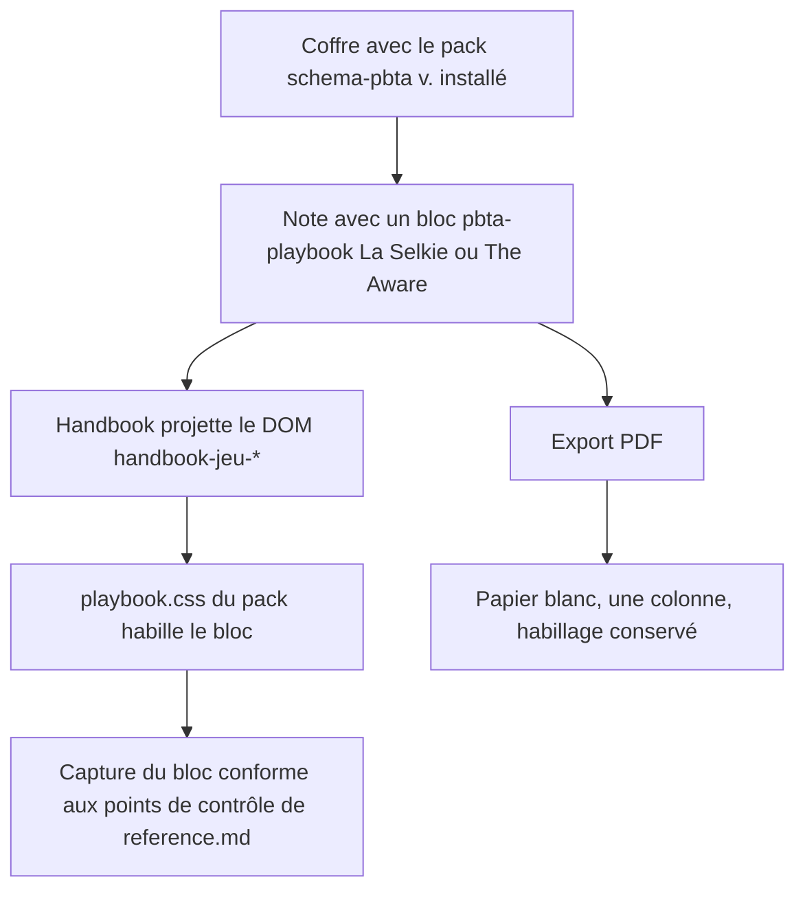
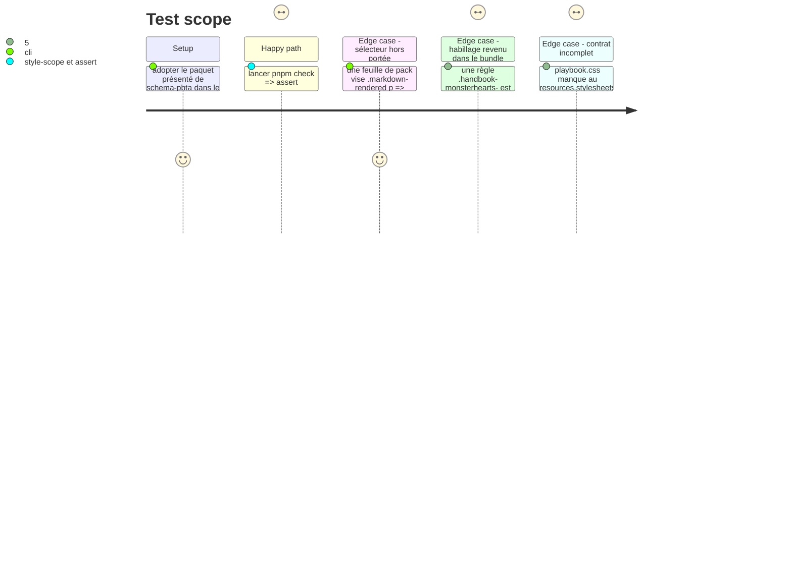

# Instruction: Handbook lit le CSS publié

## Architecture projection

> Tree of the final files. ✅ create · ✏️ modify · ❌ delete

```txt
../obsidian-handbook/
├── src/games/assets.ts ✏️ `validatePackCss` : un sélecteur qui commence par `.handbook-<id>-playbook` est préfixé de `body.brumes--<id> ` au chargement ; tout autre sélecteur hors `body.brumes--<id>` reste refusé
├── src/styles/pbta/index.scss ✏️ retirer les règles de bloc Urban Shadows (l. 96-281), reprises dans le `playbook.css` du pack ; les règles de note (l. 1-94) restent
├── src/styles/pbta/_blocks.scss ✏️ retirer le bloc `.brumes-block-scope.brumes--monsterhearts` (l. 63-291) ; les règles `.handbook-pbta-*` génériques restent
├── tools/e2e/playbook-capture.ps1 ✅ coffre temporaire (Handbook de `dist/`, packs du coffre de test, `data.json` du seul coffre temporaire), Obsidian en profil isolé avec `--remote-debugging-port`, une note `pbta-playbook` par exemple ; nettoie tout à la fin
├── tools/e2e/playbook-capture-cdp.py ✅ accepte la modale de confiance, attend le plugin, ouvre la note en lecture, capture le bloc visible en PNG et son `outerHTML`
├── tools/pbtaPlaybookStyles.harness.mts ✅ le bundle ne porte plus l'habillage Monsterhearts ; le contrat d'apparence publié (`packs/<jeu>/appearance-contract.json`, seul manifeste présent dans le paquet npm) déclare `playbook.css` pour les deux jeux ; le DOM des deux projections porte la racine et les `data-region` que vise le CSS publié
├── tools/assert-pbta-playbook-styles.mjs ✅ bundle esbuild du harnais, sur le motif des autres `assert:*`
├── package.json ✏️ script `assert:pbta-playbook-styles`, ajouté à `check` ; version v<X>.<Y+1>.0 par `pnpm version`
├── manifest.json ✏️ par `pnpm version`
├── versions.json ✏️ par `pnpm version`
├── CHANGELOG.md ✏️ section v<X>.<Y+1>.0 : l'habillage des playbooks Monsterhearts et Urban Shadows vient du pack, corrigé d'après le PDF
└── aidd_docs/memory/internal/game-packs.md ✏️ règle : l'habillage d'un bloc playbook PbtA vit dans le `playbook.css` du pack, host-neutral, jamais dans le bundle
```

## User Journey



## Test Scope



## Tasks to do

### `1)` Retirer l'habillage du bundle

> Handbook ne garde que la projection et le style générique.

1. Supprimer de `_blocks.scss` le bloc `.brumes-block-scope.brumes--monsterhearts`.
2. Supprimer de `src/styles/pbta/index.scss` les règles de bloc Urban Shadows (l. 96-281, reprises en phase 2). Laisser intactes ses règles de note (l. 1-94 : page, titres, tableaux, marque de jeu).
3. Reprendre en `tools/e2e/playbook-capture.ps1` et `playbook-capture-cdp.py` la capture de la phase 1 (scripts de session), sur le motif de `layout-regions-journey.ps1`, puis capturer La Selkie et The Aware avec le `playbook.css` présenté et les comparer aux points de contrôle.
4. Vérifier que `monsterheartsLayout.ts` et `urbanShadowsLayout.ts` posent la racine `handbook-<jeu>-playbook` et chaque `data-region` visé par le CSS publié. N'y toucher que si la garde le demande.

### `2)` Charger une feuille host-neutral

> La frontière de portée reste celle de Handbook, mais c'est l'hôte qui écrit le préfixe.

1. Dans `validatePackCss` (`src/games/assets.ts`), réécrire par postcss chaque sélecteur qui commence par `.handbook-<id>-playbook` en `body.brumes--<id> <sélecteur>`, y compris sous `@container` et `@media`. Tout autre sélecteur qui ne commence pas par `body.brumes--<id>` fait toujours refuser la feuille.
2. Le harnais (tâche 3) le prouve sur trois cas : le `playbook.css` publié est accepté et préfixé, une feuille qui vise `.markdown-rendered p` est refusée, et `.handbook-autre-jeu-playbook` est refusé dans le pack d'un autre jeu.

### `3)` Affirmer la règle

> Un retour de l'habillage dans le bundle, ou un pack qui ne déclare plus `playbook.css`, casse `check`.

1. Écrire `tools/pbtaPlaybookStyles.harness.mts` et `tools/assert-pbta-playbook-styles.mjs`. Le harnais lit `dist/styles.css`, `node_modules/schema-pbta/packs/<jeu>/appearance-contract.json` et `…/assets/styles/playbook.css`, ainsi que le DOM projeté de La Selkie et de The Aware. `handbook/<jeu>/pack.json` n'est pas dans le paquet npm : sa déclaration est gardée côté schema-pbta (phase 2).
2. Il échoue si `dist/styles.css` contient un sélecteur `.handbook-monsterhearts-` ou `.handbook-urban-shadows-`, si un contrat d'apparence ne liste pas `assets/styles/playbook.css`, ou si un `data-region` ou une classe `handbook-<jeu>-*` visés par le CSS manquent au DOM projeté. Les classes que seul un contenu absent de La Selkie ou de The Aware ferait apparaître sont listées dans le harnais, avec leur condition ; Lantern reprend la même liste (phase 4).
3. Brancher le script dans `check`. Garder `assert:style-scope` et `assert:mist-font-packs` verts.

### `4)` Version et mémoire

> La version et le CHANGELOG se préparent avec le changement.

1. `pnpm version <x.y.z>` en mineure, puis une section CHANGELOG qui annonce le changement visuel.
2. Inscrire la règle dans `aidd_docs/memory/internal/game-packs.md`.
3. Exiger `rtk proxy pnpm build` vert, puis `eslint src --ext .ts` et `pnpm lint` à zéro erreur.

## Test acceptance criteria

| Task | Acceptance criteria |
| ---- | -------------------- |
| 1 | `dist/styles.css` ne contient plus de règle `.handbook-monsterhearts-`, et le bloc garde le style générique `handbook-pbta` quand le pack est absent. |
| 2 | Le `playbook.css` publié se charge dans le coffre, préfixé de `body.brumes--<id>` ; une feuille hors portée est toujours refusée. La capture de `playbook-capture.ps1` montre les trois points de contrôle de chaque jeu. |
| 3 | `pnpm check` passe. Si l'on remet une règle `.handbook-monsterhearts-` dans le SCSS, ou si l'on retire `playbook.css` d'un contrat d'apparence, il échoue avec un message qui nomme la cause. |
| 4 | `assert:release-version` passe, et le CHANGELOG annonce le changement visuel. |

## Résultat (2026-11-09)

- Harnais : il lit le témoin publié `corpus/contract/valid/<jeu>-playbook-complete.toml` plutôt que La Selkie, qui n'est pas dans le paquet npm. Des compléments nommés (Monsterhearts : `harm`, `gear`, `identity`, `play` ; Urban Shadows : `harm`, `scars`, `gear`, `statProfiles`, `identity`) font apparaître les crochets conditionnels, si bien que la liste `CONDITIONAL` reste vide. Lantern reprend les mêmes compléments (phase 4).
- Les règles `game-identity` mortes ont été retirées de la feuille en phase 2 : aucun DOM projeté ne porte ce crochet.
- La capture (`tools/e2e/playbook-capture.ps1`) a révélé deux écarts avec le PDF, corrigés dans les deux copies de `playbook.css` :
  - Monsterhearts : les clés de caractéristique arrivent en minuscules, la feuille les capitalise (`text-transform: capitalize`) comme le PDF (« Sexy ») ;
  - Urban Shadows : les pips de statut se chevauchaient avec leur libellé ; ils sont maintenant centrés sous le cercle, avec « Statut » dessous.
  La recapture confirme les six points de contrôle de `reference.md` ; le verdict de l'utilisateur reste en phase 5.
- Mutation (critère 3) : une règle `.handbook-monsterhearts-stats` ajoutée au bundle et un contrat d'Urban Shadows sans `playbook.css` font chacun échouer le harnais avec un message qui nomme la cause. Les deux mutations ont été annulées.
- `pnpm check`, dont `check.mjs` découvre tout script `assert:*`, est vert avec le tarball local de schema-pbta, sauf trois gardes qui lisent l'épingle : `assert:consumer-schema-pins`, `assert:pbta-contract` et `assert:prove-schema-pbta-candidate`. Côté schema-pbta, seul `handbook:validate:install` échoue, pour la même raison. L'épingle publiée est restaurée : `present` adoptera la rc.
- Version 2.49.0 (`pnpm version --no-git-tag-version`, sans commit ni tag), CHANGELOG, `game-packs.md` et `tools/e2e/README.md` sont à jour. Build et les deux lints sont verts.
