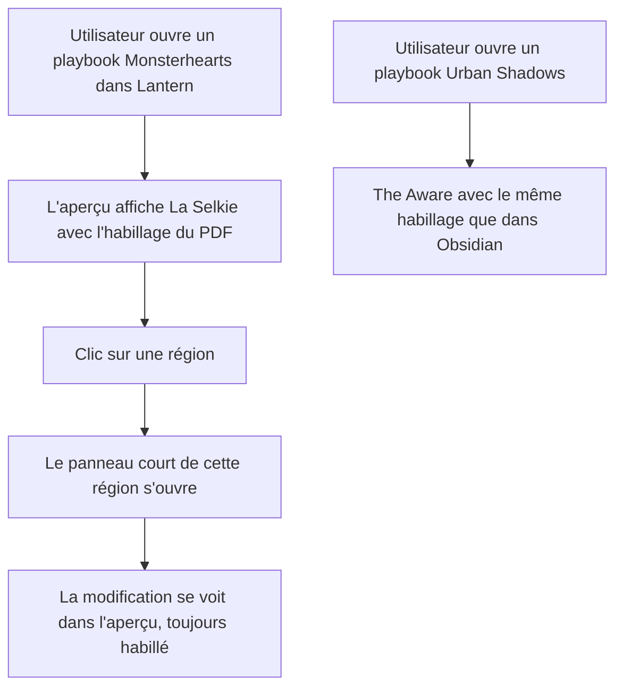
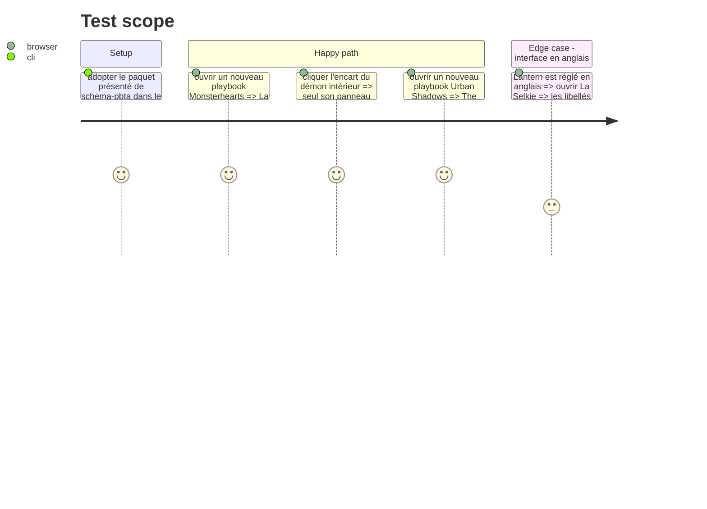

# Instruction: Lantern émet le DOM Handbook et lit le CSS publié

## Architecture projection

> Tree of the final files. ✅ create · ✏️ modify · ❌ delete

```txt
../lantern/
├── src/templates/monsterhearts/playbook/preview/MonsterheartsPlaybookPreview.tsx ✏️ émet le DOM de `monsterheartsLayout.ts` (racine `handbook-pbta-playbook handbook-monsterhearts-playbook`, `-layout-row`, `-column`, `-region[data-region]`, `-move`, `-stats`, `-row`, `-fill`…) ; importe `schema-pbta/packs/monsterhearts/assets/styles/playbook.css`
├── src/templates/monsterhearts/playbook/preview/monsterheartsPlaybookTheme.css ❌ remplacé par le CSS publié
├── src/templates/urban-shadows/playbook/preview/UrbanShadowsPlaybookPreview.tsx ✏️ racine `handbook-urban-shadows-playbook` ; importe `schema-pbta/packs/urban-shadows/assets/styles/playbook.css`
├── src/templates/urban-shadows/playbook/preview/urbanShadowsPlaybookTheme.css ❌ copie supprimée
├── src/templates/pbta/preview/playbookRegionInteraction.css ✅ seulement l'interaction de Lantern (curseur, survol, focus d'une région cliquable), aucune valeur d'habillage
├── src/templates/monsterhearts/playbook/sample.ts ✏️ l'exemple devient La Selkie, le contenu de `schema-pbta/examples/monsterhearts/monsterhearts-playbook/la-selkie.toml` recopié dans `sample.ts` (le dossier `examples/` n’est pas publié)
├── tools/assertPbtaPlaybookStyles.harness.mts ✅ rendu par `renderToStaticMarkup`, sur le motif de `assertBlockTemplates.harness.mts`
├── tools/assert-pbta-playbook-styles.mjs ✅ bundle esbuild du harnais ; ni `monsterheartsPlaybookTheme.css` ni `urbanShadowsPlaybookTheme.css` (les thèmes Masks, MotW, Sprawl et specialized restent hors périmètre) ; chaque aperçu PbtA importe le `playbook.css` publié ; le rendu de La Selkie et de The Aware porte la racine et chaque `data-region` du contrat
├── package.json ✏️ script `assert:pbta-playbook-styles`, ajouté à `check:project` ; version v<L>.<K+1>.0
└── CHANGELOG.md ✏️ section v<L>.<K+1>.0
```

## User Journey



## Test Scope



## Tasks to do

### `1)` Monsterhearts : même DOM que Handbook

> Le CSS publié ne s'accroche qu'aux points d'accroche de Handbook.

1. Réécrire le rendu de `MonsterheartsPlaybookPreview.tsx` d'après `obsidian-handbook/src/features/pbta/monsterheartsLayout.ts` : mêmes éléments, mêmes classes, mêmes `data-region`, mêmes rangées tirées de `presentation.rows`.
2. Garder le clic par région qui ouvre son panneau court, en posant le gestionnaire sur la `section` de région.
3. Importer le `playbook.css` publié et supprimer `monsterheartsPlaybookTheme.css`. Les polices restent chargées par `FontFace` depuis le paquet.

### `2)` Urban Shadows : supprimer la copie

> Le livret lit le fichier publié, plus une copie.

1. Remplacer l'import de `urbanShadowsPlaybookTheme.css` par le `playbook.css` publié.
2. Retirer l'enveloppe `.urban-shadows-doc` si la racine `handbook-urban-shadows-playbook` suffit, et supprimer la copie.

### `3)` Interaction propre à Lantern

> L'éditeur garde son retour visuel sans redéfinir l'habillage.

1. Écrire `src/templates/pbta/preview/playbookRegionInteraction.css` : curseur, survol et `:focus-visible` des régions cliquables des deux jeux. Aucune police, aucune couleur de fond, aucune géométrie.
2. L'importer dans les deux aperçus.

### `4)` Exemple La Selkie

> Lantern, Obsidian et le PDF montrent le même contenu.

1. Remplir `getSampleMonsterheartsPlaybook` avec La Selkie de `examples/monsterhearts/monsterhearts-playbook/la-selkie.toml`, slug `la-selkie`.
2. Garder `assert:block-templates` vert.

### `5)` Affirmer la règle

> Une copie qui revient, ou un DOM qui diverge, casse les validations.

1. Écrire `tools/assertPbtaPlaybookStyles.harness.mts` et son bundle `tools/assert-pbta-playbook-styles.mjs` (motif de `assert-block-templates`), qui exigent trois choses :
   - ni `monsterheartsPlaybookTheme.css` ni `urbanShadowsPlaybookTheme.css` n'existent ; les autres `*PlaybookTheme.css` (Masks, MotW, Sprawl, specialized) ne sont pas concernés ;
   - chaque aperçu PbtA importe `schema-pbta/packs/<jeu>/assets/styles/playbook.css` ;
   - le rendu serveur de La Selkie et de The Aware porte la racine `handbook-<jeu>-playbook`, chaque `data-region` du contrat publié et chaque classe `handbook-<jeu>-*` que vise le `playbook.css` publié, hormis les classes conditionnelles listées dans le harnais (la même liste que celle du harnais Handbook).
2. L'ajouter à `check:project` dans `package.json` ; la topologie du superviseur, qui lance déjà `check` pour Lantern, le joue donc dans `present`.
3. Monter la version mineure et compléter le CHANGELOG. Exiger `assert:editor-literals` et le typecheck verts.

## Test acceptance criteria

| Task | Acceptance criteria |
| ---- | -------------------- |
| 1 | Comme dans Handbook, l'aperçu Monsterhearts montre les trois points de contrôle Monsterhearts de reference.md (actions à puce coquillage, caractéristiques et cases, habillage des sections). |
| 2 | L'aperçu Urban Shadows ne change pas (la copie réunissait déjà `layout.css` et les règles de bloc de Handbook), sauf les corrections de reference.md ; la copie n'existe plus. |
| 3 | Une région survolée ou atteinte au clavier est signalée, et un clic n'ouvre que les champs de cette région. |
| 4 | Un nouveau playbook Monsterhearts affiche La Selkie. |
| 5 | Les validations de Lantern passent. Si l'on remet une copie de thème, ou si l'on retire du rendu un `data-region` ou une classe visée par le CSS, elles échouent avec un message qui nomme la cause. |
