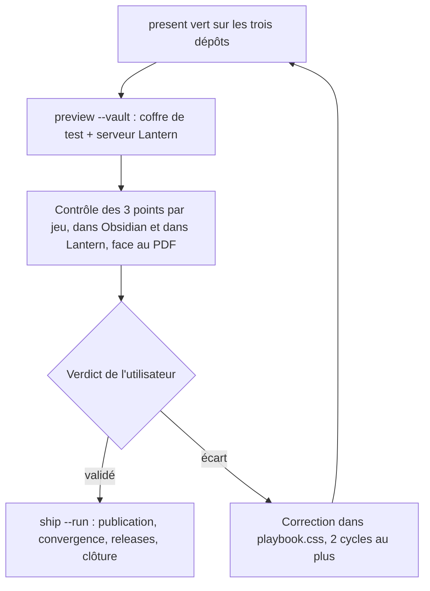

# Instruction: Verdict de rendu sur les deux outils et livraison

## Architecture projection

> Tree of the final files. ✅ create · ✏️ modify · ❌ delete

```txt
../obsidian-handbook/
├── aidd_docs/tasks/2026_11/2026_11_09_pbta-playbook-shared-styles/reference.md ✏️ colonne « verdict » des trois points de contrôle, par jeu et par outil
└── supervisor/trains/pbta-playbook-shared-styles.json ✏️ tenu par le superviseur jusqu'à `close`
```

## User Journey



## Test Scope

```mermaid
---
title: Test scope
---
journey
  section Setup
    écrire les messages de commit des trois dépôts avec Closes #N, puis commit et present => present vert: 5: cli
  section Happy path
    lancer preview --vault sur le coffre de test => Handbook déployé et serveur Lantern lancé: 5: cli
    lancer ship --run après le verdict => schema-pbta, Handbook et Lantern publiés et issues fermées: 5: cli
  section Edge case - fichiers LF laissés par present
    preview refuse uncommitted changes dans schema-pbta => vérifier git diff --ignore-cr-at-eol vide puis git checkout -- . => preview repart: 3: cli
```

## Tasks to do

### `1)` Présenter le train

> Tout se valide avant le départ.

1. Écrire le message de commit de chaque dépôt dans `git rev-parse --git-path SUPERVISOR_COMMIT_MSG`, en anglais, terminé par `Closes #N` (lantern#76 pour Lantern).
2. `pnpm supervise commit`, puis `present --root <worktrees>`. En cas d'échec, lire le journal nommé par `Whole output:`.

### `2)` Verdict de rendu

> Le verdict porte sur les points fixés en phase 1, dans les deux outils.

1. `pnpm supervise preview --vault C:/Users/fxgui/Documents/Perso/RPG/city-of-mist --root <worktrees>`, sans écraser `data.json`.
2. Capturer La Selkie et The Aware dans Obsidian et dans Lantern, à côté des recadrages PDF de `reference/`. Exporter La Selkie en PDF depuis Obsidian pour vérifier l'impression (papier blanc, une colonne).
3. Demander à l'utilisateur son verdict sur les trois points de contrôle, par jeu et par outil. Au plus deux cycles de correction dans `playbook.css` ; au-delà, revenir à l'utilisateur.

### `3)` Livrer

> Après le verdict, on exécute ; seuls les accidents arrêtent.

1. `pnpm supervise ship --run --root <worktrees>`.
2. Mettre à jour le checkout principal de Handbook par `git pull --ff-only`, sans toucher aux modifications non commitées de l'utilisateur.
3. Inscrire le verdict dans reference.md, et les pièges rencontrés dans la mémoire du projet.

## Test acceptance criteria

| Task | Acceptance criteria |
| ---- | -------------------- |
| 1 | `present` est vert pour schema-pbta, Handbook et Lantern, avec les nouvelles gardes dans leurs validations. |
| 2 | L'utilisateur a validé les trois points de contrôle de chaque jeu, dans Obsidian comme dans Lantern, et l'export PDF de La Selkie sort sur papier blanc. |
| 3 | schema-pbta v<N>.<M+1>, Handbook v<X>.<Y+1>.0 et Lantern v<L>.<K+1>.0 sont publiés, et lantern#76 ainsi que les issues du train sont fermées. |
