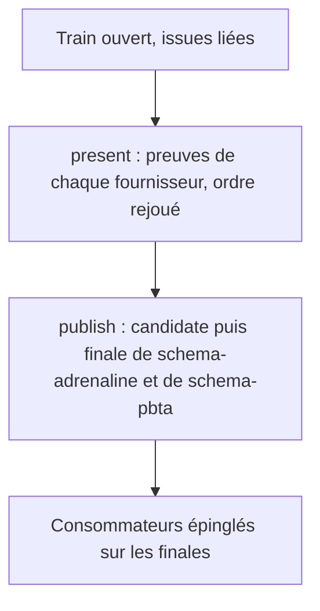
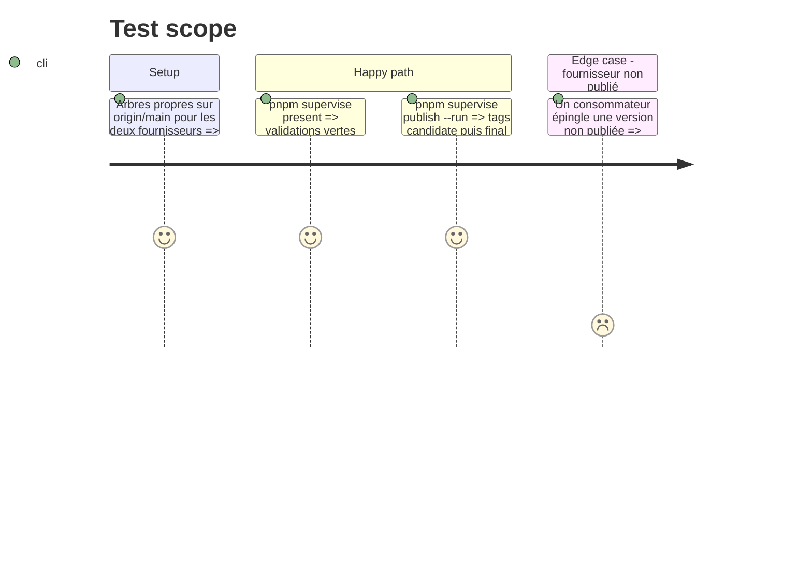

<!-- Fill or omit these sections; never add, rename, or reorder one. -->

# Instruction: Fournisseurs : publier schema-pbta et schema-adrenaline

Issues : schema-pbta#53 (15.0.1) et schema-adrenaline#51 (6.4.0). Les deux versions sont sur `origin/main` de leur dépôt, sans tag ; Handbook et Lantern épinglent encore 15.0.0 et 6.3.0.

## Architecture projection

> Tree of the final files. ✅ create · ✏️ modify · ❌ delete

```txt
obsidian-handbook/
├── supervisor/trains/feuille-relations.json       ✅ fichier de train (fournisseurs, consommateurs, issues liées)
└── package.json, pnpm-lock.yaml                    ✏️ épingles des deux fournisseurs (par le superviseur, à la publication)
lantern/
└── package.json, package-lock.json                 ✏️ idem (par le superviseur)
schema-adrenaline/
└── handbook/adrenaline/pack.json                   ✏️ `requires` + `block:adrenaline-relations` (commit fournisseur, avant la candidate ; voir phase 2, tâche 3)
```

## User Journey



## Test Scope



## Tasks to do

### `1)` Préparer le train

> Les deux fournisseurs et les quatre issues sont dans un train, avant tout code consommateur.

1. Ouvrir le train (`pnpm supervise open`) et y lier schema-pbta#53, schema-adrenaline#51, lantern#81, obsidian-handbook#139, ainsi que lantern#78, lantern#79 et obsidian-handbook#137, dont le code attend sa livraison (`pnpm supervise link`). L'ouverture se fait quand les phases 2 et 3 sont prêtes à être commitées : `present` exige des arbres propres sur `origin/main`.
2. Ordre de publication : les deux fournisseurs avant les consommateurs ; entre eux, selon la topologie (aucune dépendance entre schema-pbta et schema-adrenaline).

### `2)` Un paquet à consommer pendant le codage

> Les phases 2 et 3 compilent et se prouvent sans paquet publié.

1. Tant que schema-adrenaline 6.4.0 n'est pas publié, Handbook et Lantern s'installent sur une épingle tarball locale (`pnpm pack` du checkout du fournisseur), non commitée et restaurée avant `present` (l'épingle de `package.json` est celle que le superviseur réécrit).
2. Constater que `RELATIONS_PRESENTATION`, `ATTITUDE_LEVELS` et les codecs `parseRelationsToml` / `stringifyRelationsToml` sont exportés par ce paquet, et que le corpus `corpus/temoins/relations` et `corpus/refus/relations` s'y trouve.

### `3)` Publier les finales

> La publication des finales se joue dans le train de la phase 4, après les phases 2 et 3.

1. `present`, puis `ship --run` : les fournisseurs sont publiés d'abord, les consommateurs ensuite.

## Test acceptance criteria

| Task | Acceptance criteria |
| ---- | ------------------- |
| 1 | Le train nomme les deux fournisseurs et les quatre issues ; `present` accepte le fichier. |
| 2 | Handbook et Lantern installent le tarball local et importent `RELATIONS_PRESENTATION` sans erreur de type ; l'épingle locale est absente du commit de train. |
| 3 | Après le train, Handbook et Lantern épinglent les finales (schema-adrenaline 6.4.0, schema-pbta 15.0.1) et les deux issues fournisseurs sont closes par le commit de train. |
