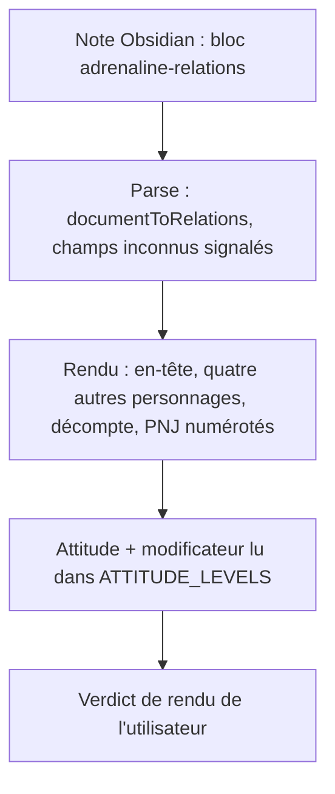
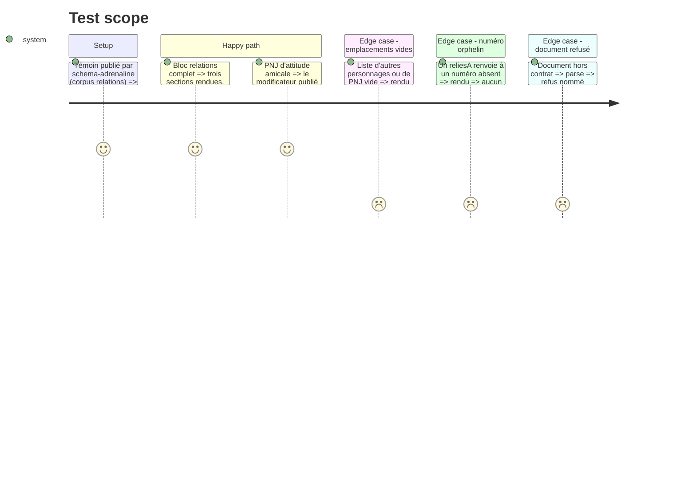

<!-- Fill or omit these sections; never add, rename, or reorder one. -->

# Instruction: Handbook : rendre la feuille de relations

Issue : obsidian-handbook#139. Modèle à copier : le bloc `adrenalinePj` pour le rendu de feuille (racine, surface `paper-sheet`, mixin `sheet`) et `adrenalinePnj` pour la conservation du document source (`rememberAdrenalineSource`).

## Architecture projection

> Tree of the final files. ✅ create · ✏️ modify · ❌ delete

```txt
obsidian-handbook/
├── src/features/adrenalineRelations/              ✅ block.ts, parser.ts, schema.ts (documentToRelations), shape.ts, template.ts, renderer.ts (formes `name-card`, `pc-ties`, `counter`, `npc-entries`)
├── src/features/adrenaline/publishedContract.ts   ✏️ `AdrenalineSheet` étendu à `relations`, schéma publié chargé
├── src/features/blocks/registry.ts                ✏️ enregistrement du bloc
├── src/features/blocks/tomlExports.ts             ✏️ export TOML du bloc
├── src/features/printPageBreaks/index.ts          ✏️ saut de page de la feuille
├── src/games/capabilities.ts                      ✏️ `block:adrenaline-relations` dans les blocs d'Adrenaline
├── src/styles/adrenaline/_relations.scss          ✅ habillage (cadres, deux colonnes de cinq fiches, quatre emplacements)
├── src/styles/adrenaline/index.scss               ✏️ @use et @include de la nouvelle feuille de style
├── tools/assertAdrenalineRelations.harness.mts    ✅ harnais (témoins publiés, vide, refus)
├── tools/assert-adrenaline-relations.mjs          ✅ lanceur
├── tools/assertAdrenalineSource, contextualPackBlocks, customPacks (.harness.mts) ✏️ listes de capacités à quatre blocs
└── package.json                                   ✏️ script assert:adrenaline-relations
schema-adrenaline/
└── handbook/adrenaline/pack.json                  ✏️ `block:adrenaline-relations` dans `requires` (commit fournisseur, hors Handbook)
```

## User Journey



## Test Scope



## Tasks to do

### `1)` Lire et conserver le document

> Parseur tolérant sur le contrat publié, source conservée pour la réécriture.

1. Écrire `documentToRelations` à partir des codecs publiés (`parseRelationsToml`) : `warnUnknownKeys`, `contractRefusal`, aucune sémantique locale.
2. Étendre `AdrenalineSheet` (`publishedContract.ts`) à `relations` et brancher la conservation du source (`rememberAdrenalineSource`).
3. Libellés français d'abord.

### `2)` Rendre selon la présentation publiée

> `RELATIONS_PRESENTATION` pilote le rendu ; aucun repli.

1. Rendre `name-card`, `pc-ties` (quatre emplacements côte à côte, `fieldRows` de chaque élément), `counter` (tests de drame) et `npc-entries` (deux colonnes de cinq fiches, remplies colonne par colonne) dans le rendu dédié de la feuille : la présentation publiée reste le seul pilote ; une forme inconnue se signale et se rend en lignes simples.
2. Imprimer le nombre d'emplacements du `maxItems` du schéma ; ni `pages` ni `minimumRows`.
3. `attitudeLevels` : imprimer le modificateur (`bonus` / `malus` / `aucun` et nombre) après l'attitude saisie, lu dans `ATTITUDE_LEVELS`.
4. Saut de page propre à la feuille (A4 séparée de la fiche PJ).

### `3)` Enregistrer le bloc et la capacité

> Le bloc existe pour l'utilisateur, la capacité est exigée par le pack.

1. Enregistrer le bloc (`registry.ts`, `tomlExports.ts`, `printPageBreaks`, `capabilities.ts`) et mettre à jour les trois harnais qui énumèrent les capacités d'Adrenaline.
2. Dans schema-adrenaline, ajouter `block:adrenaline-relations` au `requires` de `handbook/adrenaline/pack.json` (le fichier porte `version` du pack, à incrémenter, et `minimumHandbookVersion`, à porter sur la version de Handbook qui rend la feuille : celle que `pnpm version` fixe pour ce changement, lue de `package.json` et non recopiée d'avance) : commit fournisseur posé sur `origin/main` **avant** `present`, donc avant la candidate. Ce commit relève de la même issue (#51).

### `4)` Prouver

> Un harnais, deux moitiés : témoin qui passe, refus qui échoue.

1. `assert:adrenaline-relations` : témoin du corpus publié rendu, vide, modificateurs, document refusé ; échoue si `RELATIONS_PRESENTATION` change de forme.
2. Les témoins et refus sont ceux du paquet (`corpus/temoins/relations/{temoin,pleine-capacite}.json`, `corpus/refus/relations/*.json`), lus dans `node_modules/schema-adrenaline` comme le fait `assert:session-notes` : Handbook n'en recopie aucun. `rtk proxy pnpm build`, `eslint src --ext .ts`, `pnpm lint` et `pnpm check` verts.
3. Rendu dans le coffre de test pour le verdict de la phase 4 : la référence (feuille papier de relations) se nomme avant le rendu.

## Test acceptance criteria

| Task | Acceptance criteria |
| ---- | ------------------- |
| 1 | Le témoin publié se lit ; un champ inconnu est signalé sans échec ; un document hors contrat est refusé en nommant la cause. |
| 2 | Les trois sections se rendent selon la présentation ; le nombre d'emplacements égale le `maxItems` ; le modificateur d'attitude s'imprime et n'est jamais lu du document. |
| 3 | Le bloc `adrenaline-relations` est proposé comme les autres blocs Adrenaline ; le pack exige la capacité et se charge. |
| 4 | `assert:adrenaline-relations` et `pnpm check` verts ; le harnais échoue quand on casse le rendu (constaté). |
