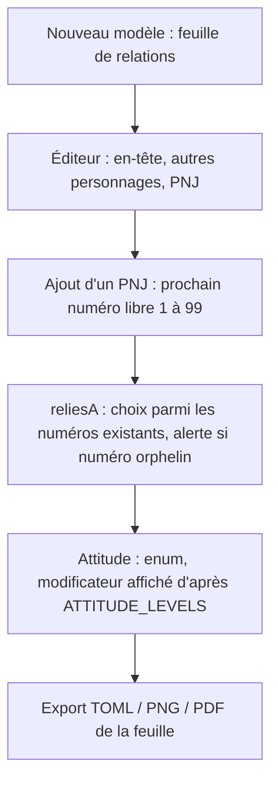
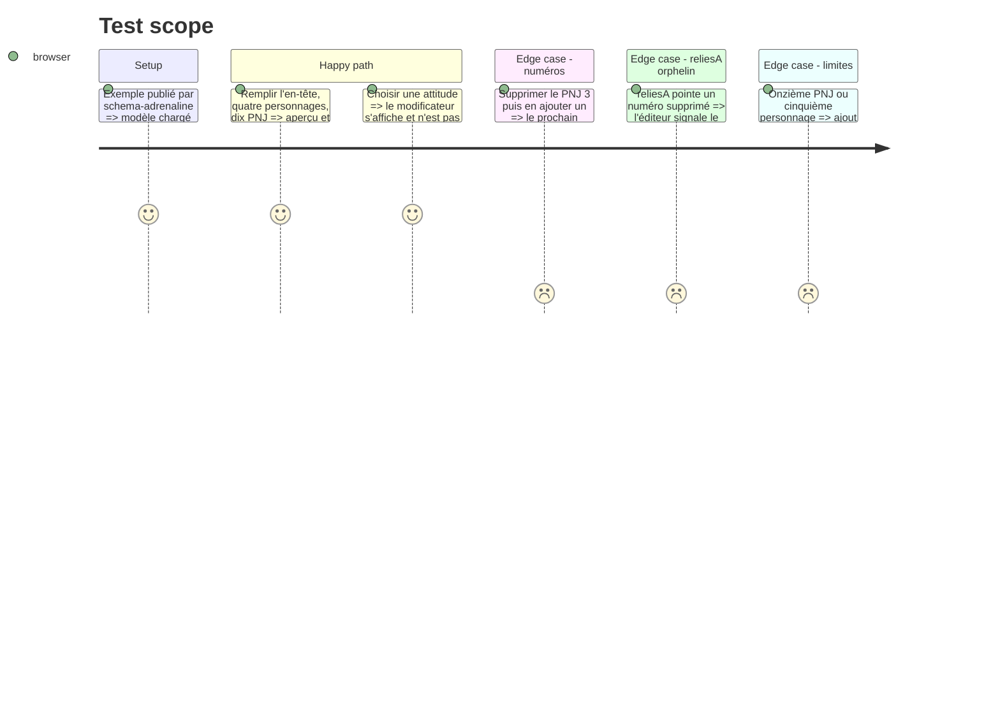

<!-- Fill or omit these sections; never add, rename, or reorder one. -->

# Instruction: Lantern : éditer la feuille de relations

Issue : lantern#81. Modèle à copier : `src/templates/adrenaline/pnj/` (descripteur, `definition.tsx`, éditeur, aperçu, exemple, TOML), enregistré par `core/templates/registry.tsx` et `templateLoader.ts` ; aperçu bâti sur `shared/preview` (CompactCard, PresentationBlocks, SheetPrimitives). Référence d'éditeur : Legend in the Mist.

## Architecture projection

> Tree of the final files. ✅ create · ✏️ modify · ❌ delete

```txt
lantern/
├── src/templates/adrenaline/relations/            ✅ descriptor, definition.tsx, editor, preview, sample, toml
├── src/core/templates/registry.tsx, templateLoader.ts ✏️ enregistrement du modèle
├── src/templates/adrenaline/shared/preview/PresentationBlocks.tsx ✏️ table `FORMS` : formes `pc-ties`, `counter`, `npc-entries` (absentes), et `TITLED_ELSEWHERE` si elles impriment leur titre
├── src/i18n/locales/{fr,en}                       ✏️ libellés de l'éditeur : aucune chaîne en dur
├── tools/assertRelations.harness.mts              ✅ harnais (numéros, reliesA, modificateur)
└── package.json                                   ✏️ script assert:relations, ajouté à check:project
```

## User Journey



## Test Scope



## Tasks to do

### `1)` Modèle et exemple

> La feuille est un modèle Lantern à part entière.

1. Créer le dossier `relations` sur le modèle de `pnj` ; exemple tiré du corpus publié ; TOML par les codecs publiés.
2. Enregistrer dans le registre et le chargeur ; l'aperçu consomme `RELATIONS_PRESENTATION`, sans repli local.

### `2)` Éditeur

> Panneaux courts, un clic sur une zone n'ouvre que ses champs ; aucune chaîne en dur, tout suit la langue de Lantern.

1. En-tête : personnage (requis), joueur, partie.
2. Autres personnages (4 au plus) : nom, ce que je sais, ce que je lui dois, ce qu'il me doit.
3. PNJ (10 au plus) : prochain numéro libre à la création, stable ensuite ; `reliesA` proposé parmi les numéros existants, avec alerte sur un numéro orphelin ; attitude dans l'enum, modificateur affiché d'après `ATTITUDE_LEVELS` ; lien (type et description).
4. Décompte des tests de drame : entier de 0 à 100.

### `3)` Export et preuve

> L'export global (PNG / PDF / TOML) couvre la feuille.

1. Vérifier que l'export par pages et le TOML incluent la feuille ; l'ajouter à la couverture de présentation (`assert:presentation-coverage`) et au harnais d'export (`assert:export-pages`).
2. `assert:relations` : prochain numéro libre, stabilité, `reliesA` orphelin, modificateur non stocké, limites 4 / 10 / 0 à 100 ; ajouté à `check:project`, donc aux validations de `present` (topologie).
3. `npm run check:project` vert.

## Test acceptance criteria

| Task | Acceptance criteria |
| ---- | ------------------- |
| 1 | Le modèle s'ouvre avec l'exemple publié ; le TOML produit se relit par le codec publié sans perte. |
| 2 | Le prochain numéro libre est attribué et ne change plus ; un `reliesA` orphelin est signalé ; le modificateur s'affiche d'après le contrat et ne se saisit pas ; les limites sont tenues. |
| 3 | `assert:relations` et `npm run check:project` verts ; la feuille figure dans l'export PNG, PDF et TOML. |
