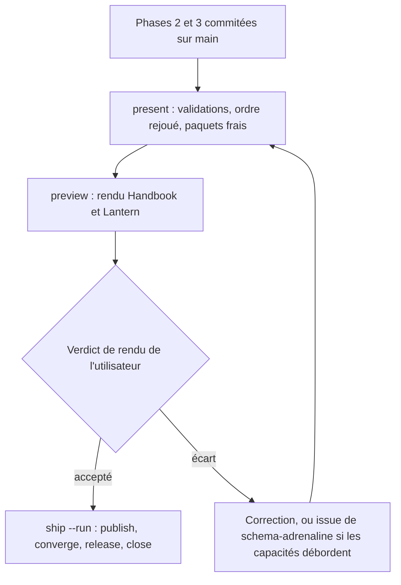
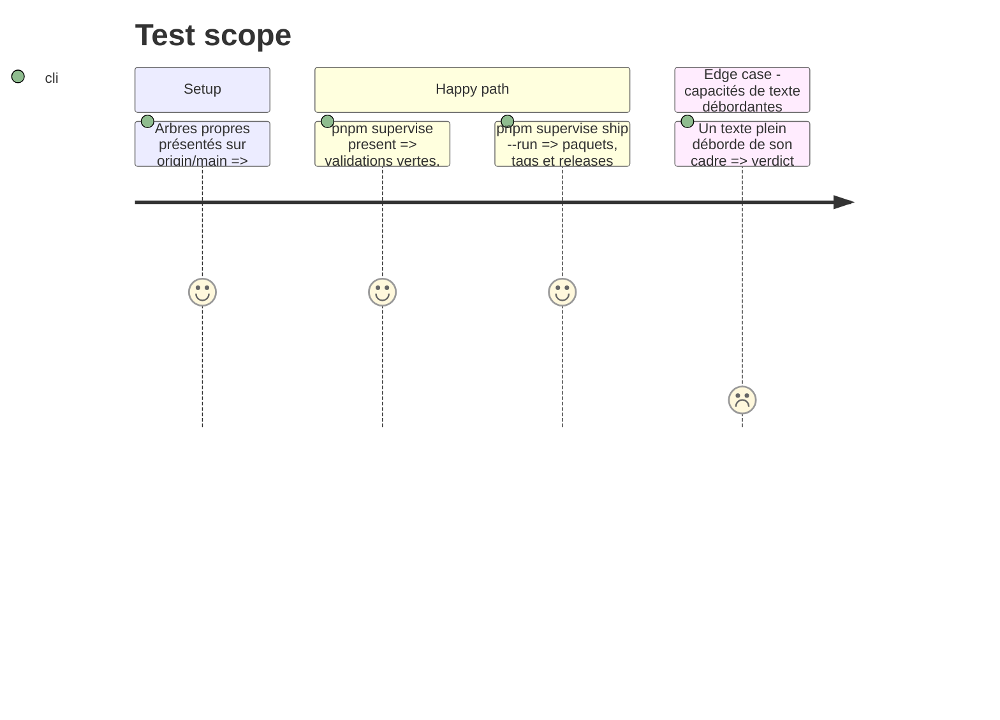

<!-- Fill or omit these sections; never add, rename, or reorder one. -->

# Instruction: Train : livraison et verdict de rendu

Les quatre issues : schema-pbta#53, schema-adrenaline#51, lantern#81, obsidian-handbook#139. La référence de rendu (feuille papier de relations d'Adrenaline, à fournir par l'utilisateur) se nomme **avant** le rendu ; sans elle, le verdict porte sur la présentation publiée.

## Architecture projection

> Tree of the final files. ✅ create · ✏️ modify · ❌ delete

```txt
obsidian-handbook/
└── supervisor/trains/feuille-relations.json       ✏️ train complet (créé en phase 1)
```

## User Journey



## Test Scope



## Tasks to do

### `1)` Présenter

> Tout se contrôle avant le départ.

1. Commit (sur demande explicite de l'utilisateur) de tout ce qui attend : phases 2 et 3, commit fournisseur du `requires` de schema-adrenaline, et le travail non commité des suites (code des notes de Handbook et ses docs de plan, fichier `supervisor/trains/notes-de-partie.json`, changements de Lantern). Arbres propres sur `origin/main`, épinglage tarball local retiré.
2. `pnpm supervise present` ; en cas d'échec, lire le journal complet de la ligne `Whole output:`.

### `2)` Verdict de rendu

> Seul le verdict de rendu est demandé ; le reste s'enchaîne.

1. `pnpm supervise preview` ; rendre la feuille de relations pleine dans Handbook (coffre de test, sans écraser `data.json`) et dans Lantern.
2. Mesurer contre la référence nommée (tailles, deux colonnes de cinq fiches, quatre emplacements, modificateurs) et demander le verdict à l'utilisateur.

### `3)` Livrer

> Après le verdict, on exécute.

1. `pnpm supervise ship --run` : schema-pbta et schema-adrenaline d'abord (candidate puis finale), puis Lantern et Handbook ; le commit de train se termine par les `Closes #` des issues.
2. Constater les épingles finales dans les deux consommateurs, les releases de Handbook et de Lantern, la clôture des quatre issues.

## Test acceptance criteria

| Task | Acceptance criteria |
| ---- | ------------------- |
| 1 | `present` est vert sur les quatre dépôts. |
| 2 | L'utilisateur a rendu un verdict sur la feuille de relations pleine, dans Handbook et dans Lantern ; tout écart est une correction ou une issue nommée. |
| 3 | schema-adrenaline 6.4.0 et schema-pbta 15.0.1 sont publiés et épinglés ; les quatre issues sont closes ; Handbook et Lantern ont une release. |
