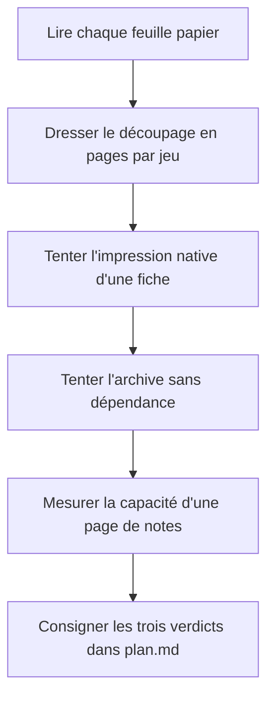
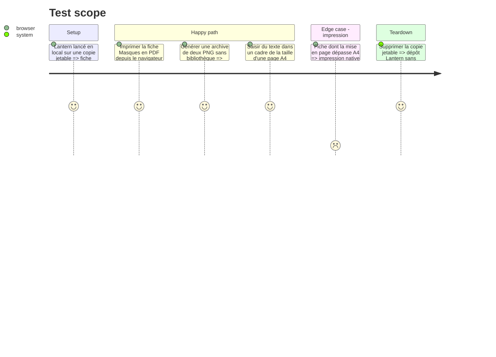

# Instruction: Inventaire des pages papier et tentatives de faisabilité

## Architecture projection

> Tree of the final files. ✅ create · ✏️ modify · ❌ delete

```txt
obsidian-handbook/
└── aidd_docs/tasks/2026_11/2026_11_20_notes-de-partie-export-par-pages/
    ├── inventaire-pages.md                    ✅ une ligne par fiche : feuille papier, nombre de pages, recto / verso, zones par page
    └── plan.md                                ✏️ tableau Decisions : capacité de la page, archive, fidélité du PDF
lantern/
└── (aucun fichier suivi : les tentatives se font dans une copie jetable, supprimée avant la fin)
```

## User Journey



## Test Scope



## Tasks to do

### `1)` Inventaire des pages

> Chaque fiche a son découpage en pages, tiré de sa feuille papier.

1. Lire les références nommées au plan pour Adrenaline PJ, Otherscape, Masques, Monster of the Week, Monsterhearts, The Sprawl et Urban Shadows.
2. Trancher la référence de la fiche Adrenaline PJ (une ou deux pages) en la comparant au contrat `pj` et à la feuille papier à jour de la mémoire du projet.
3. Pour chaque fiche, consigner dans `inventaire-pages.md` : le nombre de pages, le verso éventuel, les zones de présentation par page, et si l'aperçu actuel tient à l'échelle d'une page A4 ou doit être remis en page.
4. Repérer la référence papier du livret Monster of the Week ; sinon noter qu'il suit les faces que le pack déclare.

### `2)` Impression native

> Le PDF par `window.print()` est-il assez fidèle pour être proposé ?

1. Sur une copie jetable de Lantern, ajouter une feuille `@media print` / `@page` A4 minimale et imprimer une fiche Masques puis une fiche Adrenaline PJ.
2. Comparer au PNG du même état : polices, couleurs de fond, coupes de page, texte sélectionnable.
3. Noter dans `plan.md` si l'impression native est retenue telle quelle, retenue avec réserves ou refusée (et alors faire revenir la décision à l'utilisateur).

### `3)` Archive sans dépendance

> L'archive d'un PNG par page se produit-elle sans bibliothèque ?

1. Tenter l'écriture d'une archive non compressée à la main sur deux PNG et l'ouvrir dans l'explorateur de fichiers.
2. Noter le verdict dans `plan.md` ; en cas d'échec, y inscrire la bibliothèque retenue et la raison.

### `4)` Capacité de la page de notes

> La taille d'une page de notes est une mesure, pas un chiffre deviné.

1. Mesurer ce qui tient dans une zone de texte de la taille d'une page A4, dans la police et la taille de chaque jeu du périmètre, avec du texte en paragraphes et du texte en lignes courtes.
2. Retenir, par paquet `schema-*`, la valeur de la page la plus étroite de ses jeux (valeur du `maxLength`), et noter que le refus de saisie se fait aussi sur la hauteur rendue.
3. Ne recopier la valeur que dans le contrat.

## Test acceptance criteria

| Task | Acceptance criteria |
| ---- | ------------------- |
| 1 | `inventaire-pages.md` donne, pour chaque fiche du périmètre, son nombre de pages, son verso éventuel et les zones de chaque page ; la référence d'Adrenaline PJ est tranchée. |
| 2 | Le PDF de la fiche Masques et celui d'Adrenaline PJ sortent en A4, texte sélectionnable ; le verdict (retenue, retenue avec réserves, refusée) est dans `plan.md`. |
| 3 | Une archive de deux PNG s'ouvre dans l'explorateur de fichiers, ou la bibliothèque retenue est nommée dans `plan.md` avec sa raison. |
| 4 | La capacité de chaque paquet est consignée avec la mesure qui la fonde, pour les deux types de texte. |
