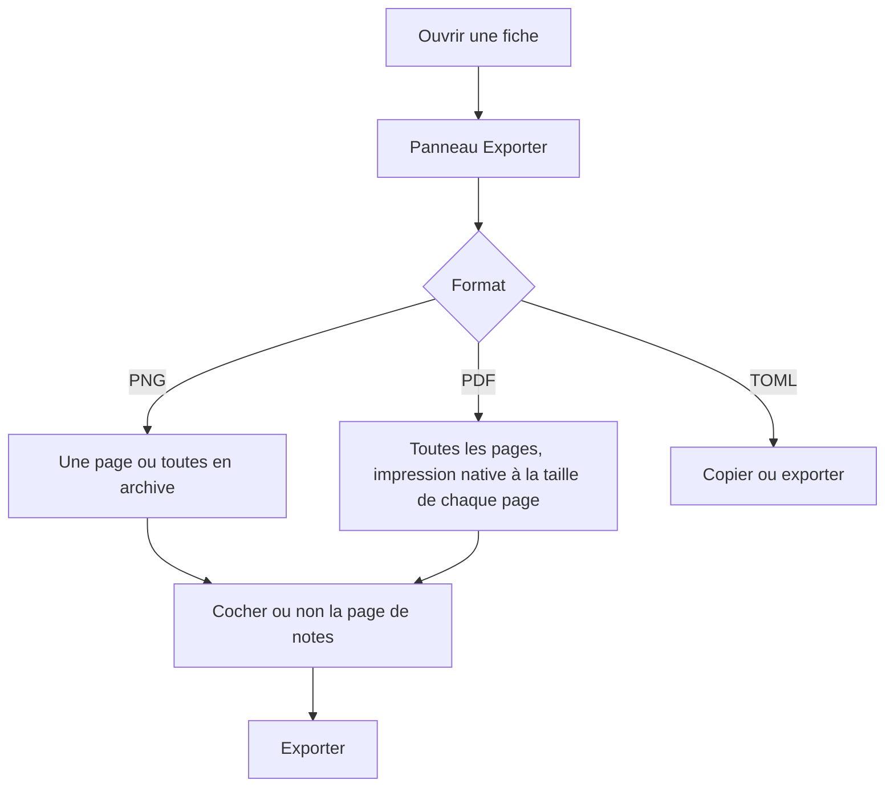
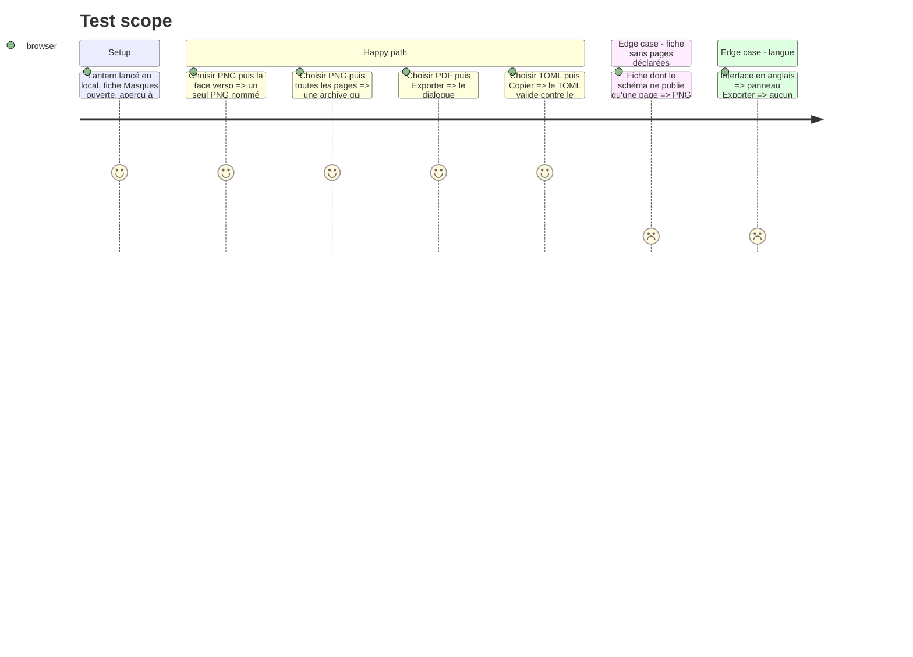

# Instruction: Export par pages et contrôle « Exporter » global

## Architecture projection

> Tree of the final files. ✅ create · ✏️ modify · ❌ delete

```txt
lantern/
├── src/core/templates/types.ts                                  ✏️ `TemplateDefinition.export.pages` : liste de pages (id, libellé, nœud d'aperçu) ; `TemplateExportAction` reçoit les pages choisies
├── src/core/templates/shell/TemplateExportPanel.tsx             ✏️ bouton « Exporter » unique, bascule PNG / PDF / TOML, options du format choisi
├── src/core/templates/shell/imageExportAction.ts                ✏️ PNG d'une page choisie ou de toutes les pages
├── src/core/templates/shell/archiveExport.ts                    ✅ une archive, un PNG par page (selon le verdict de la phase 1)
├── src/core/templates/shell/pdfExportAction.ts                  ✅ impression native de toutes les pages, une `@page` nommée par page
├── src/core/templates/shell/tomlExportAction.ts                 ✏️ inchangé dans son rôle, branché sur la bascule
├── src/core/templates/shell/exportPages.ts                      ✅ retrouve les nœuds de page dans la racine d'aperçu (attribut `data-export-page="<id>"`, `getRootSelector` ne change pas)
├── src/styles/print.css, src/styles/index.css                   ✅ ✏️ `@page` nommées (une par page, à la taille de la page), `@media print` sur une racine d'impression au niveau de `body` : une page par nœud, fonds conservés, page de notes masquée quand elle est exclue ; importé par `index.css`
├── src/templates/masks/playbook/preview/MasksPlaybookPreview.tsx ✏️ marque chaque face `data-export-page` (première cible, épreuve du mécanisme)
├── src/templates/masks/playbook/definition.tsx                  ✏️ déclare ses faces comme pages, lues des faces déjà publiées par `schema-pbta`
├── src/i18n/locales/{fr,en}/export.ts                           ✏️ libellés : Exporter, format, page, toutes les pages, archive, inclure la page de notes, inclure les notes
├── tools/assert-template-exports.mjs, tools/assertTemplateExports.harness.mts  ✏️ l'action d'export change de forme : le harnais existant suit
├── tools/assert-export-pages.mjs, tools/assertExportPages.harness.mts          ✅ pages dérivées du contrat, jamais d'un nombre en dur
└── package.json                                                 ✏️ script `assert:export-pages` ajouté à `check:project`
```

## User Journey



## Test Scope



## Wireframe

```txt
┌───────────────────────────────────────────┐
│ [1] Exporter                              │
├───────────────────────────────────────────┤
│ [2] ( PNG )  ( PDF )  ( TOML )            │
├───────────────────────────────────────────┤
│ [3] Options du format choisi              │
│  PNG :  Pages  (•) Une page  ( ) Toutes   │
│         [ Page : Recto ▾ ]                │
│         Échelle [ 2x ▾ ]                  │
│         ☑ Inclure la page de notes        │
│  PDF :  Toutes les pages              │
│         ☑ Inclure la page de notes        │
│         (dialogue d'impression du         │
│          navigateur)                      │
│  TOML : ☑ Inclure les notes               │
│         [ Copier dans le presse-papiers ] │
├───────────────────────────────────────────┤
│ [4] [        Exporter        ]            │
└───────────────────────────────────────────┘
```

1. Titre du panneau.
2. Bascule de format : un seul choix à la fois ; choisir un format change le bloc 3.
3. Options propres au format : choix d'une page ou de toutes (archive), échelle, case « Inclure la page de notes » (PNG, PDF) ou « Inclure les notes » (TOML) ; le TOML garde sa zone de texte et son action « Copier » ; son export en fichier passe par le bouton global du bloc 4. Les cases n'apparaissent que sur une fiche qui a une page de notes.
4. Bouton d'export global, unique ; il lance l'action du format choisi.

## Tasks to do

### `1)` Pages d'une fiche

> Une fiche déclare ses pages, l'export les lit.

1. Ajouter à la définition d'un gabarit la liste de ses pages ; une fiche à une page n'en déclare qu'une. Pour Masques, la liste vient des faces recto / verso déjà publiées par `schema-pbta` ; la généralisation aux autres fiches vient de la phase 3.
2. `exportPages.ts` retrouve le nœud d'aperçu de chaque page par son attribut `data-export-page` dans la racine d'aperçu.
3. Marquer les deux faces de l'aperçu Masques et les déclarer comme pages (première cible).

### `2)` PNG par page et archive

> Une page précise, ou tout dans une archive.

1. Étendre l'action PNG : une page choisie, ou toutes.
2. `archiveExport.ts` assemble un PNG par page, nommé d'après la fiche et la page, selon le verdict de la phase 1.
3. Prévoir l'exclusion de la page de notes quand la case est décochée : la page n'existe pas encore, la logique (un identifiant de page « notes » écarté de la liste) est prête et éprouvée à la phase 4.

### `3)` PDF natif

> Toutes les pages, à leur taille, texte sélectionnable.

1. `pdfExportAction.ts` imprime les pages par l'impression native du navigateur, sans rien ajouter à l'interface du navigateur.
2. `print.css` pose des `@page` nommées (taille lue de la présentation publiée, jamais en dur), une page par nœud, les fonds conservés, sur une racine d'impression clonée sous `body` (verdict de la phase 1) ; la page de notes exclue est masquée par un attribut posé sur la racine pendant l'impression et retiré ensuite.

### `4)` Contrôle « Exporter » global

> Un bouton, une bascule, les options du format.

1. Remplacer, dans `TemplateExportPanel`, l'onglet-plus-bouton par le bouton « Exporter » et la bascule PNG / PDF / TOML du wireframe, en gardant l'ossature existante.
2. Afficher les options du format choisi ; le TOML garde sa zone de texte et « Copier » (l'export en fichier est le bouton global) ; la case « Inclure les notes » retire le champ de notes du TOML produit.
3. Libellés FR et EN dans les locales ; aucune chaîne en dur (`assert:editor-literals`).

### `5)` Harnais

> Les pages d'une fiche se dérivent du contrat, jamais d'un nombre.

1. `assert:export-pages` vérifie, sur le corpus, que chaque page déclarée a un nœud d'aperçu et que le nombre de pages est lu de la source qui le déclare.
2. Adapter `assert:template-exports` à la nouvelle forme de l'action d'export et ajouter `assert:export-pages` à `check:project` ; la vérification complète de Lantern reste verte, typecheck inclus.

## Test acceptance criteria

| Task | Acceptance criteria |
| ---- | ------------------- |
| 1 | La fiche Masques expose deux pages (recto, verso) ; une fiche sans pages déclarées n'en expose qu'une. |
| 2 | « Une page » télécharge un seul PNG ; « Toutes » télécharge une archive qui contient un PNG par page. |
| 3 | Le PDF imprimé a une page par face, à la taille de la face (aucune page blanche), texte sélectionnable, fonds conservés. |
| 4 | Le panneau montre un seul bouton « Exporter » ; changer de format change les options affichées ; l'interface anglaise n'a aucun libellé français. |
| 5 | `assert:export-pages` est vert et lit le nombre de pages dans la source qui le déclare ; `assert:template-exports` reste vert avec la nouvelle forme d'action. |
