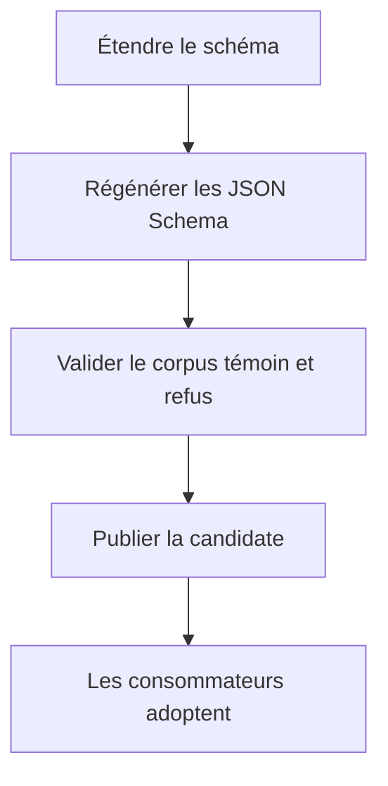
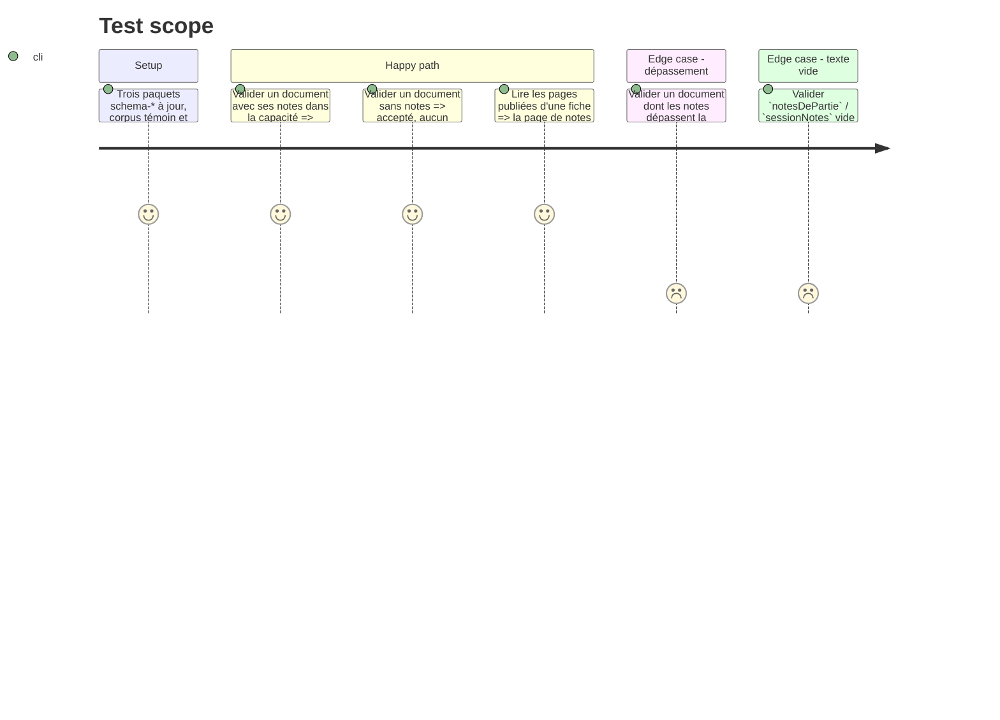

# Instruction: Contrat des notes de partie et des pages

## Architecture projection

> Tree of the final files. ✅ create · ✏️ modify · ❌ delete

```txt
schema-adrenaline/
├── src/zod/adrenaline/pj.ts                          ✏️ cible `pj` : champ `notesDePartie` optionnel, texte, `maxLength` publié (`notes` existe déjà dans des sous-objets : nom distinct)
├── src/presentation.ts                               ✏️ pages de la fiche (feuille papier de l'inventaire) et page « Notes de partie » toujours dernière
├── schemas/                                          ✏️ JSON Schema régénéré
├── corpus/temoins/, corpus/refus/                    ✏️ témoin avec et sans notes, refus au-delà de la capacité
├── CHANGELOG.md, package.json                        ✏️ version candidate v<N+1> (mineure)
└── (harnais de contrat du paquet)                    ✏️ le champ est optionnel : un document sans `notesDePartie` reste valide
schema-in-the-mist/
├── src/zod/                                          ✏️ cible `otherscape/character` : champ `sessionNotes`
├── src/presentation.ts                               ✏️ pages et page de notes
├── corpus/                                           ✏️ témoins et refus, dans la forme propre au corpus du paquet (`contract/`)
├── CHANGELOG.md, package.json                        ✏️ version candidate v<N+1>
schema-pbta/
├── src/zod/playbook.ts                               ✏️ schéma de base `playbookSchema` : champ `sessionNotes` commun, hérité par les cibles `*-playbook` et par l'alias Salvage Run
├── src/presentation/*-playbook.ts                    ✏️ faces généralisées en pages ; page de notes
├── corpus/contract/, harnais de couverture / alias   ✏️ le champ ne crée ni « non résolu » ni alias orphelin ; témoins et refus
├── CHANGELOG.md, package.json                        ✏️ version candidate v<N+1>
obsidian-handbook/
└── aidd_docs/tasks/2026_11/2026_11_20_notes-de-partie-export-par-pages/plan.md  ✏️ tableau Decisions : version publiée de chaque paquet, par rôle
```

## User Journey



## Test Scope



## Tasks to do

### `1)` Champ de notes

> Un champ de texte libre, optionnel, de capacité publiée.

1. Ajouter le champ de notes à chaque cible de fiche du périmètre, dans les trois paquets : `notesDePartie` (Adrenaline), `sessionNotes` (Otherscape et PbtA) ; texte, optionnel, avec `maxLength` fixé à la valeur mesurée à la phase 1 pour ce paquet.
2. Dans `schema-pbta`, une seule définition, posée sur `playbookSchema` : les cibles spécialisées l'héritent, l'alias Salvage Run aussi.
3. Régénérer les JSON Schema et relancer le harnais de couverture / alias de `schema-pbta` : le champ n'ajoute aucune entrée « non résolue ».

### `2)` Pages publiées

> Le découpage en pages vit dans les métadonnées de présentation.

1. Pour chaque fiche, déclarer ses pages d'après `inventaire-pages.md` ; les faces recto / verso des livrets PbtA deviennent des pages.
2. Déclarer la page « Notes de partie » comme dernière page, avec son libellé FR et EN publié dans le schéma, et le lien vers le champ de notes qu'elle porte.
3. Une fiche à une seule feuille déclare une page, plus celle des notes.
4. Pour `schema-pbta`, vérifier que la généralisation des faces en pages ne change pas la sémantique des faces déjà publiées (aucune régression de ce que le paquet déclare).

### `3)` Corpus et harnais

> Les deux moitiés du corpus sont nécessaires.

1. Témoins : un document avec notes, un sans, dans le corpus de chaque paquet.
2. Refus : un document dont les notes dépassent la capacité.
3. Les harnais de chaque paquet lisent la capacité dans le schéma (le `maxLength` du champ), jamais un littéral.
4. Lancer la vérification complète de chaque paquet : verte avant de publier.

### `4)` Versions et publication

> Publier avant d'adopter.

1. Version mineure candidate par paquet, section du CHANGELOG.
2. Publier chaque candidate (pré-version, que Lantern et Handbook épinglent pour la preuve) ; la version finale est promue par le train de la phase 6. Noter dans `plan.md` le rôle de chaque version (candidate v<N+1>, finale v<N+1>), sans la recopier en littéral ailleurs.

## Test acceptance criteria

| Task | Acceptance criteria |
| ---- | ------------------- |
| 1 | Un document de chaque fiche du périmètre accepte ses notes ; un document sans notes reste valide ; le harnais de couverture / alias de `schema-pbta` n'a aucune entrée « non résolue » de plus. |
| 2 | Les pages d'une fiche sont lisibles depuis les métadonnées publiées et la page de notes est la dernière. |
| 3 | Le corpus témoin passe et le refus « notes au-delà de la capacité » est rejeté dans les trois paquets. |
| 4 | Les trois candidates sont publiées et leur rôle est noté dans `plan.md` ; la vérification complète de chaque paquet est verte. |
