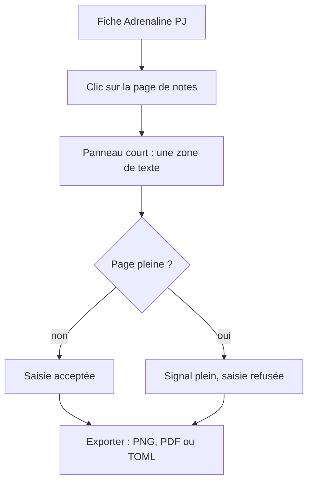
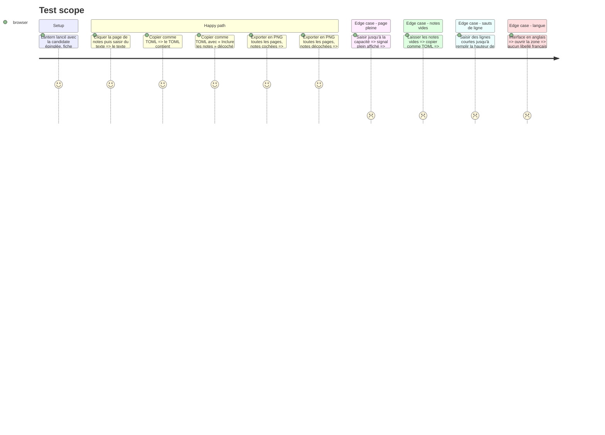

# Instruction: Page « Notes de partie » sur la fiche Adrenaline PJ

## Architecture projection

> Tree of the final files. ✅ create · ✏️ modify · ❌ delete

```txt
lantern/
├── package.json, pnpm-lock.yaml                                  ✏️ épingle la candidate schema-adrenaline v<N+1>
├── src/templates/shared/notes/                                   ✅ composants communs à tous les jeux, créés ici une fois pour toutes (la phase 5 les réemploie) :
│   ├── NotesForm.tsx                                             ✅ zone de texte, compteur, signal « plein », refus de saisie (capacité lue du schéma, hauteur rendue mesurée)
│   └── NotesPage.tsx                                             ✅ la page de notes, taille fixe, dernière page de l'aperçu, marquée `data-export-page`
├── src/templates/adrenaline/shared/{model.ts,metadata.ts,toml.ts} ✏️ champ `notesDePartie` (clé du contrat, absent du TOML quand il est vide)
├── src/templates/adrenaline/pj/
│   ├── sample.ts, toml.ts, descriptor.ts                         ✏️ échantillon, TOML, descripteur : le champ de notes
│   ├── preview/PjPreview.tsx                                     ✏️ aperçu découpé en pages selon la feuille papier de l'inventaire, puis page de notes
│   ├── editor/zone.ts                                            ✏️ zone « Notes de partie » (courte, une zone = ses champs)
│   └── definition.tsx                                            ✏️ pages issues du contrat, cases « Inclure la page de notes » et « Inclure les notes » (TOML)
├── src/core/templates/shell/exportPages.ts                       ✏️ exclusion de la page de notes (logique prévue en phase 2)
├── src/i18n/locales/{fr,en}/adrenaline.ts, common.ts             ✏️ libellés de la zone, compteur et signal « plein » (partagés dans `common.ts`)
├── tools/assert-adrenaline-pj.mjs, tools/assertAdrenalinePj.harness.mts ✏️ codec de la fiche sur le corpus : `notesDePartie` aller-retour TOML
├── tools/assert-export-pages.mjs                                 ✏️ notes en dernière page, exclusion
└── CHANGELOG.md, package.json                                    ✏️ version v<N+1> de Lantern
```

## User Journey



## Test Scope



## Wireframe

```txt
┌──────────────────────────────────────────────────────────────┐
│ [1] Aperçu : page 1 … page N (fiche), puis page de notes      │
│                                                              │
│ ┌──────────────────────────────────────────────┐            │
│ │ [2] NOTES DE PARTIE                          │            │
│ │  (texte libre, taille de page fixe)          │            │
│ │  …                                           │            │
│ │                                              │            │
│ └──────────────────────────────────────────────┘            │
└──────────────────────────────────────────────────────────────┘
 Panneau latéral court, une zone à la fois
 ┌──────────────────────────────────────────┐
 │ [3] Notes de partie                      │
 │ ┌──────────────────────────────────────┐ │
 │ │ zone de texte                        │ │
 │ └──────────────────────────────────────┘ │
 │ [4] 1 240 / capacité        ⚠ Page pleine │
 └──────────────────────────────────────────┘
```

1. Aperçu de la fiche : les pages de la feuille papier, puis la page de notes en dernière position.
2. Page de notes : taille fixe, rendue comme une page de la fiche.
3. Panneau court : une seule zone de texte (modèle LitM : un clic n'ouvre que les champs de la zone).
4. Compteur et signal « plein » : le signal apparaît à la capacité publiée et la saisie suivante est refusée.

## Tasks to do

### `1)` Modèle, TOML et pages

> `notesDePartie` dans la fiche, absent quand il est vide ; aperçu découpé en pages.

1. Épingler la candidate de `schema-adrenaline` dans Lantern (lockfile inclus) ; ajouter `notesDePartie` au modèle, à l'échantillon, au TOML et aux métadonnées.
2. Le codec reste un aller-retour exact sur le corpus.
3. Découper l'aperçu de la fiche en pages selon la feuille papier tranchée à la phase 1 (le choix B impose de découper les fiches existantes) : chaque page est un nœud marqué `data-export-page`, la page de notes vient en dernier.

### `2)` Page et éditeur

> Une page de notes de taille fixe et sa zone d'édition.

1. `NotesPage.tsx` (dans `templates/shared/notes`) rend la page à la dimension d'une page de la fiche.
2. `NotesForm.tsx` : zone de texte, compteur, signal « plein », refus de la saisie au-delà de la capacité publiée (lue du schéma, jamais recopiée) **et** dès que la hauteur rendue déborde la page.
3. Zone « Notes de partie » dans `zone.ts` ; libellés FR et EN dans les locales (`assert:editor-literals`).

### `3)` Branchement de l'export

> La page de notes se choisit, s'exclut, s'archive.

1. Déclarer les pages de la fiche depuis le contrat publié, notes en dernière position.
2. Brancher la case « Inclure la page de notes » du panneau « Exporter » sur le PNG, l'archive et le PDF, et « Inclure les notes » sur le TOML.

### `4)` Harnais et version

> Les harnais connaissent le champ ; la version se prépare avec le changement.

1. Étendre `assert:adrenaline-pj` (aller-retour de `notesDePartie`) et `assert:export-pages` (notes en dernière page, exclusion).
2. Version v<N+1> de Lantern (selon sa procédure de version) et section du CHANGELOG.

### `5)` Rendu

> Verdict de l'utilisateur sur l'aperçu, avant le train.

1. Montrer dans le navigateur la fiche, la page de notes pleine, un PNG d'une page, l'archive avec et sans notes, le PDF.
2. Présenter la fiche à côté de la référence papier nommée au plan.

## Test acceptance criteria

| Task | Acceptance criteria |
| ---- | ------------------- |
| 1 | Le TOML copié contient `notesDePartie` quand il est rempli, n'en contient pas quand il est vide, et valide contre `pj` ; l'aperçu de la fiche est découpé en pages selon la feuille papier. |
| 2 | La page de notes a la taille d'une page de la fiche ; à la capacité de caractères comme à la hauteur pleine, le signal « plein » apparaît et la saisie suivante est refusée. |
| 3 | L'archive contient la page de notes quand la case est cochée et ne la contient pas quand elle est décochée ; le PDF suit la même case ; le TOML retire les notes quand « Inclure les notes » est décoché. |
| 4 | La vérification complète de Lantern est verte, typecheck inclus ; `package.json` et la dernière section du CHANGELOG portent la version v<N+1>. |
| 5 | Les trois points de contrôle du plan sont montrés dans le navigateur, et le verdict de l'utilisateur est recueilli. |
