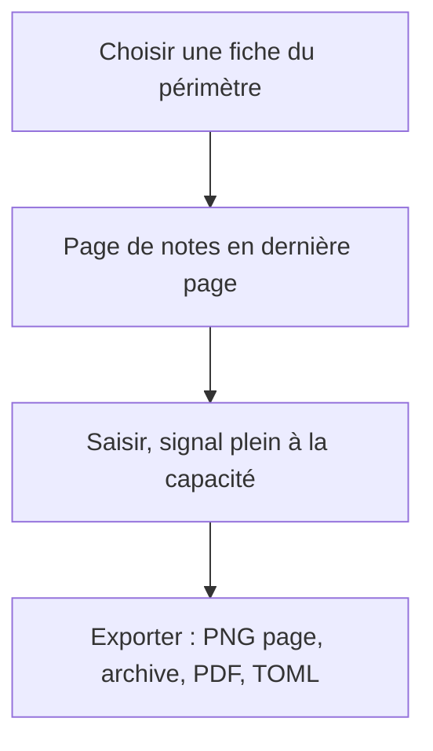
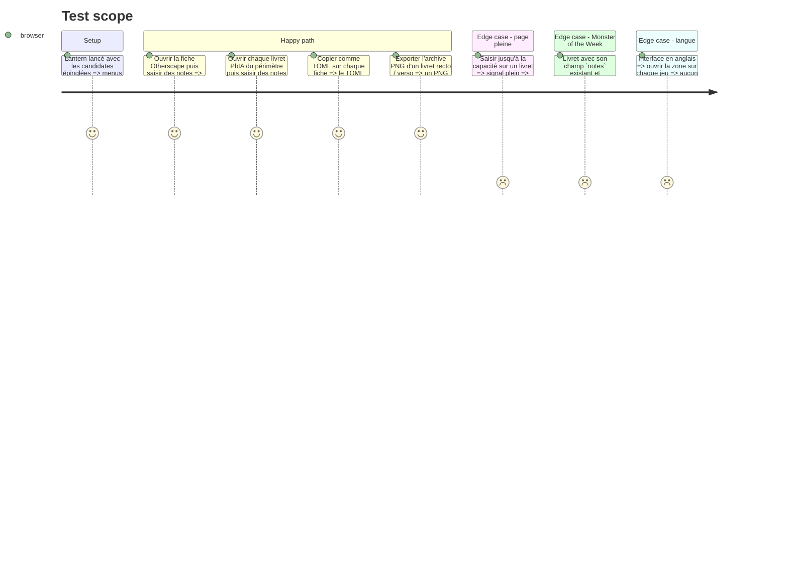

# Instruction: Page « Notes de partie » sur Otherscape et les fiches PbtA

## Architecture projection

> Tree of the final files. ✅ create · ✏️ modify · ❌ delete

```txt
lantern/
├── package.json, pnpm-lock.yaml                                  ✏️ épingle les candidates schema-in-the-mist et schema-pbta v<N+1>
├── src/templates/shared/notes/                                   (existe depuis la phase 4) NotesPage, NotesForm, signal « plein » : réemployés tels quels, jamais dupliqués
├── src/templates/otherscape/character/
│   ├── model.ts, toml.ts, sample.ts, metadata.ts                 ✏️ champ `sessionNotes`
│   ├── zoneLabels.ts, editor/CharacterEditorPanel.tsx            ✏️ zone « Notes de partie » (courte)
│   ├── preview/                                                  ✏️ aperçu découpé en pages selon la feuille papier, puis page de notes
│   └── definition.tsx                                            ✏️ pages issues du contrat, cases « Inclure la page de notes » / « Inclure les notes »
├── src/templates/{masks,monster-of-the-week,monsterhearts,the-sprawl,urban-shadows}/playbook/
│   ├── model.ts, toml.ts, sample.ts (+ metadata.ts quand le dossier en a un) ✏️ champ `sessionNotes`
│   ├── editor/                                                   ✏️ zone « Notes de partie » dans le panneau du livret
│   ├── preview/                                                  ✏️ page de notes après les faces
│   └── definition.tsx                                            ✏️ pages issues du contrat (faces recto / verso généralisées)
├── src/templates/pbta/{playbook,specialized}/                    ✏️ idem pour le livret générique et pour les livrets spécialisés (dont l'alias Salvage Run)
├── src/i18n/locales/{fr,en}/{otherscape,pbta}.ts                 ✏️ libellés propres au jeu ; compteur et signal « plein » restent dans `common.ts`
├── tools/assertOtherscapeFields.harness.mts                      ✏️ `sessionNotes` en aller-retour sur le corpus
├── tools/assert-pbta-notes.mjs, tools/assertPbtaNotes.harness.mts ✅ `sessionNotes` en aller-retour sur chaque livret du périmètre ; ajouté à `check:project`
├── tools/assert-presentation-coverage.mjs                        ✏️ la page de notes publiée est dessinée et éditable
└── CHANGELOG.md, package.json                                    ✏️ version v<N+1> de Lantern
```

## User Journey



## Test Scope



## Tasks to do

### `1)` Réemploi du composant partagé

> Une page de notes, un seul composant pour tous les jeux.

1. Importer `NotesPage`, `NotesForm` et le signal « plein » de `templates/shared/notes` (créés à la phase 4) ; si un jeu demande un réglage, le passer en propriété, sans copier le composant.
2. Vérifier (revue, ou garde de rôle) qu'aucun second composant de page de notes n'existe dans le dépôt.

### `2)` Otherscape

> La fiche Otherscape a sa page de notes.

1. Épingler la candidate de `schema-in-the-mist` ; ajouter `sessionNotes` au modèle, au TOML, à l'échantillon et aux métadonnées.
2. Découper l'aperçu de la fiche selon la feuille papier de l'inventaire ; zone « Notes de partie » et pages issues du contrat ; types de carte laissés en anglais.

### `3)` Livrets PbtA

> Chaque livret du périmètre a sa page de notes et ses pages par face.

1. Épingler la candidate de `schema-pbta` ; ajouter `sessionNotes` aux livrets Masques, Monster of the Week, Monsterhearts, The Sprawl, Urban Shadows, `pbta/playbook` et `pbta/specialized` (Monster of the Week garde son champ `notes` existant, distinct).
2. Les faces recto / verso deviennent les pages de l'export ; la page de notes vient en dernier.
3. Un livret dont le pack ne publie que le livret n'ajoute aucun gabarit : on n'invente pas d'outil hors gamme.

### `4)` Harnais et version

> Les harnais connaissent le champ sur chaque jeu.

1. Étendre `assert:otherscape-fields`, créer `assert:pbta-notes` (ajouté à `check:project`) et étendre `assert:export-pages` et `assert:presentation-coverage` à chaque jeu du périmètre.
2. Version v<N+1> de Lantern (selon sa procédure de version) et section du CHANGELOG.

## Test acceptance criteria

| Task | Acceptance criteria |
| ---- | ------------------- |
| 1 | Chaque jeu réemploie le composant de la phase 4 ; aucun doublon de page de notes dans le dépôt. |
| 2 | La fiche Otherscape accepte des notes, les exporte en TOML valide et les place en dernière page de l'aperçu. |
| 3 | Chaque livret du périmètre accepte des notes, signale la page pleine, exporte une page par face et la page de notes ; le livret Monster of the Week garde son champ `notes` intact ; aucun gabarit nouveau n'apparaît pour un jeu dont le pack ne publie que le livret. |
| 4 | La vérification complète de Lantern est verte, typecheck inclus ; `package.json` et la dernière section du CHANGELOG portent la version v<N+1>. |
