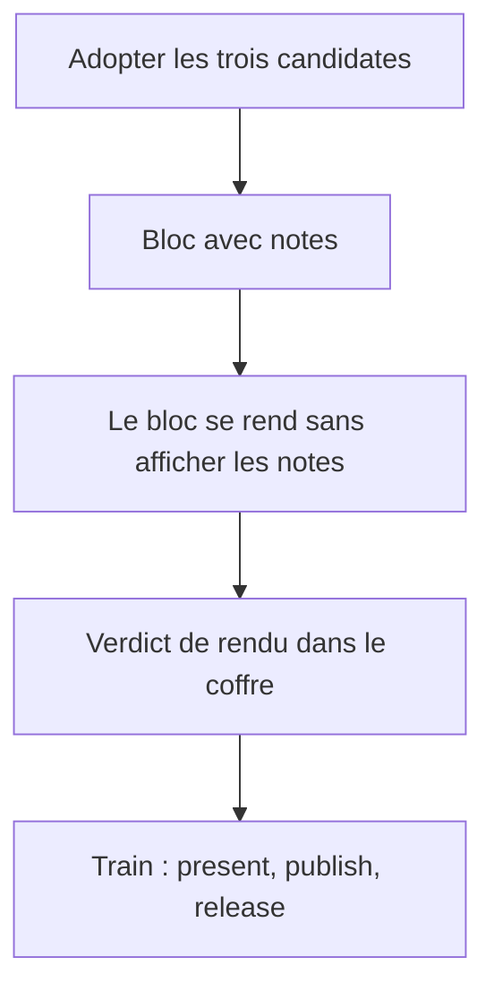
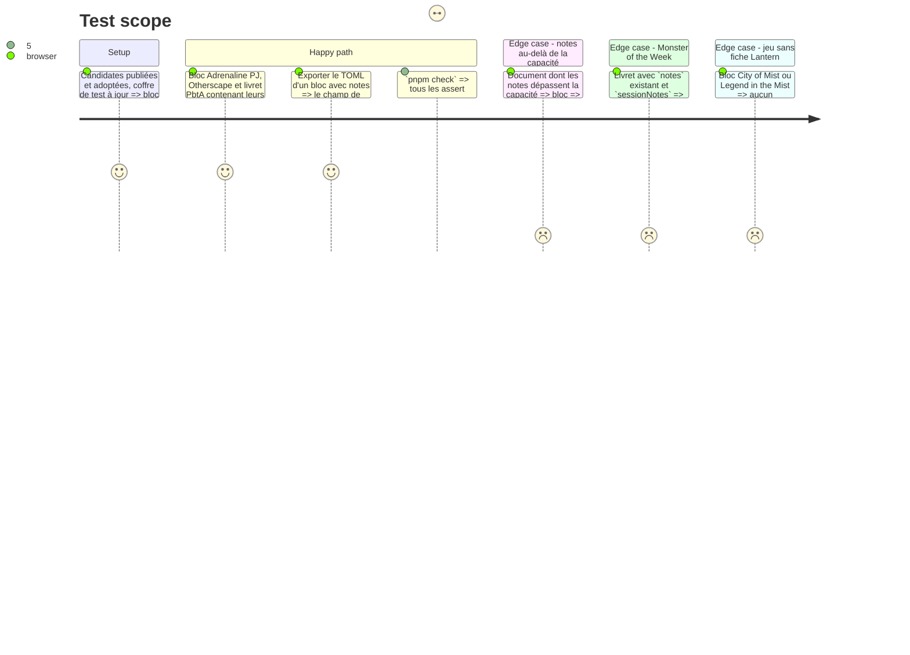

# Instruction: Handbook : adoption du contrat, verdict, train

## Architecture projection

> Tree of the final files. ✅ create · ✏️ modify · ❌ delete

```txt
obsidian-handbook/
├── package.json, pnpm-lock.yaml                                  ✏️ épingle les candidates schema-adrenaline, schema-in-the-mist et schema-pbta v<N+1>
├── src/features/{adrenalinePj,osCharacter,pbta}/                 ✏️ tolèrent `notesDePartie` / `sessionNotes` : bloc inchangé, champ ignoré au rendu (`shape.ts` ou `schema.ts` mis à jour si l'un énumère les champs connus)
├── src/features/blocks/tomlExports.ts                            ✏️ vérifié : le TOML exporté d'un bloc conserve le champ de notes quand il est présent (aucun changement si le codec publié le garde déjà)
├── tools/assert-pbta-contract.mjs, assert-corpus.mjs, assert-release-train-*  ✏️ les compteurs sur les déclarations de Handbook restent des égalités
├── corpus/temoins/                                               ✏️ témoins avec les notes
├── corpus/refus/                                                 ✏️ refus : notes au-delà de la capacité publiée
├── CHANGELOG.md, package.json, manifest.json, versions.json      ✏️ version v<N+1> de Handbook, par `pnpm version <x.y.z>`
└── aidd_docs/tasks/2026_11/2026_11_20_notes-de-partie-export-par-pages/plan.md  ✏️ statut du plan ; décision sur l'affichage des notes
```

## User Journey



## Test Scope



## Tasks to do

### `1)` Adoption

> Handbook adopte le contrat publié, sans repli local.

1. Épingler les trois candidates publiées ; aucun repli sémantique local.
2. Les blocs concernés tolèrent `notesDePartie` / `sessionNotes` et ne l'affichent pas (hypothèse du plan, à confirmer au verdict).
3. L'export TOML d'un bloc conserve le champ.

### `2)` Corpus et harnais

> Les deux moitiés du corpus.

1. Témoin avec notes, refus avec notes trop longues ; la capacité du refus est lue du schéma publié.
2. Les compteurs sur les déclarations de Handbook restent des égalités ; ceux sur les corpus amont, des planchers.

### `3)` Rendu et verdict

> Le verdict de l'utilisateur vient avant le train.

1. Déployer dans les coffres de test selon `CLAUDE.md` (sans écraser `data.json`).
2. Pas de nouveau verdict de conception de rendu ici (celui de la phase 4 a servi) : montrer un bloc de chaque jeu avec notes, rendu comme sans, et ne demander que la question de l'affichage des notes dans les blocs ; consigner la décision dans `plan.md`.

### `4)` Version et train

> Tout se contrôle dans `present`, le reste s'exécute.

1. `pnpm version <x.y.z>` (version de Handbook, jamais à la main) et section du CHANGELOG.
2. `rtk proxy pnpm build`, `eslint src --ext .ts` et `pnpm lint` à zéro erreur, puis `pnpm check`.
3. Train par le superviseur : `present` valide (les candidates épinglées y sont prouvées), puis `publish` promeut les candidates en versions finales, `converge`, `release` et `close` exécutent ; commit de train qui finit par « Closes # » seulement si un ticket existe.
4. Passer `status` du plan à `implemented` une fois les phases faites.

## Test acceptance criteria

| Task | Acceptance criteria |
| ---- | ------------------- |
| 1 | Un bloc de chaque jeu du périmètre contenant ses notes se rend comme sans ; le TOML exporté conserve le champ de notes. |
| 2 | Le témoin avec notes passe et le refus « notes trop longues » est rejeté ; `pnpm check` est vert. |
| 3 | Un bloc de chaque jeu avec notes est montré, la réponse sur l'affichage des notes est recueillie et notée dans `plan.md`. |
| 4 | `package.json`, `manifest.json`, `versions.json` et la dernière section du CHANGELOG portent la version v<N+1> ; le build et les deux portées de lint sont verts ; le train est clos. |
