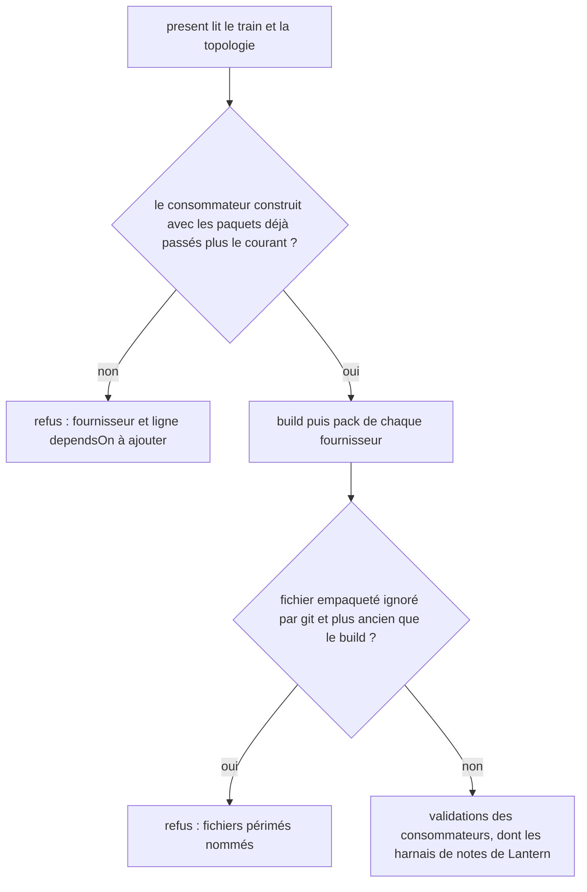
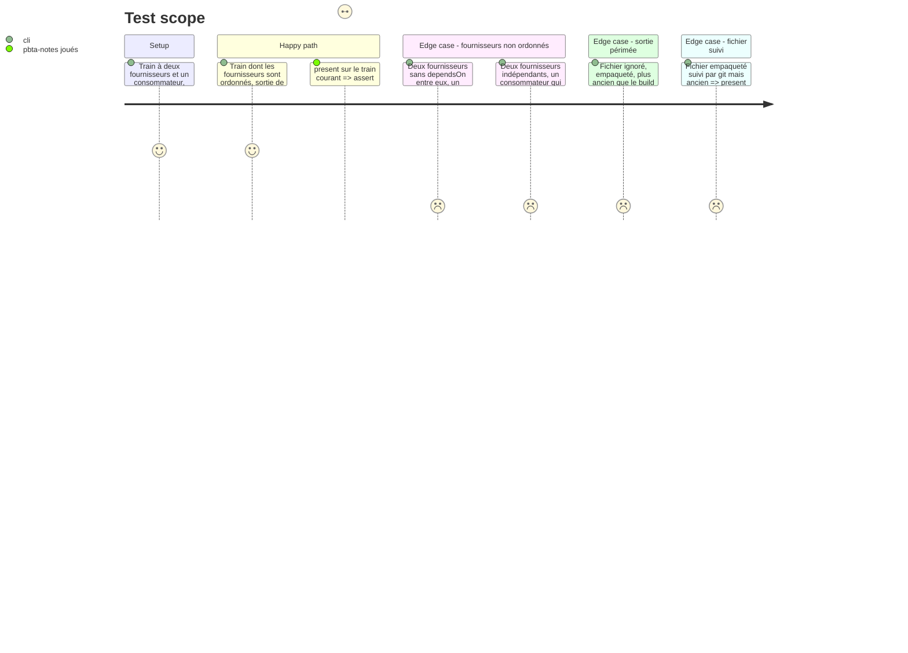

<!-- Fill or omit these sections; never add, rename, or reorder one. -->

# Instruction: Superviseur : ordre des fournisseurs, paquet périmé, validations de Lantern

Issues : obsidian-handbook#138 et #136.

## Architecture projection

> Tree of the final files. ✅ create · ✏️ modify · ❌ delete

```txt
obsidian-handbook/
├── tools/supervisor/present.mjs         ✏️ refuse un train dont les fournisseurs d'un même consommateur ne sont pas ordonnés ; refuse un paquet qui embarque un fichier de build périmé
├── tools/supervisor/packedFiles.mjs     ✏️ rend aussi, pour chaque fichier empaqueté, s'il est ignoré par git et sa date de modification
├── tools/supervisor/publish.mjs         ✏️ seulement le message : un échec d'ordre renvoie à la validation de `present`, aucune réparation
├── tools/ (harnais lu par assert:supervisor)  ✏️ cas de refus et de passage des deux détections
├── supervisor/topology.json             ✏️ validations de Lantern : les harnais de `check:project` qui y manquent
└── doc/supervisor.fr.md                 ✏️ § `present` : les deux refus ; § validations : lien avec `check:project` de Lantern
```

## User Journey



## Test Scope



## Tasks to do

### `1)` Ordre des fournisseurs (#138, premier cas)

> Un ordre faux se voit au départ, pas à la quatrième minute de `publish`.

1. Établir d'abord le signal, sans quoi la règle refuse à tort : exiger un ordre entre tous les fournisseurs listés par un consommateur condamnerait tout train à fournisseurs réellement indépendants (dans `notes-de-partie`, Adrenaline passait sans lien parce qu'il venait en premier à égalité, et rien ne l'exigeait d'être ordonné avec les deux autres). Constat de départ : `present` valide les consommateurs avec **tous** les paquets présentés ensemble, alors que la preuve de `publish` construit le consommateur avec **un** paquet à la fois, les autres fournisseurs à leur version publiée. L'écart est là.
2. Option retenue par défaut : dans `present`, rejouer la construction du consommateur dans l'ordre de `providerOrder`, en n'installant que les paquets des fournisseurs déjà passés plus le courant ; un échec nomme le fournisseur dont la preuve échouerait et la ligne `dependsOn` à ajouter à l'item du suivant. Si le mécanisme de `present` ne permet pas ce rejeu à un coût tenable, repli : documenter la règle dans `doc/supervisor.fr.md` (seconde option de #138) et le dire dans les Decisions, sans règle statique.
3. `publish` ne refait pas ce rejeu ; son message d'accident renvoie à la validation de `present`.
4. Harnais : le train de `notes-de-partie` tel qu'il était (sans l'ordre) est refusé, avec l'ordre il passe, et un train de fournisseurs indépendants dont le consommateur n'exige qu'un seul passe sans lien ajouté.

### `2)` Paquet présenté périmé (#138, second cas)

> Ce qui est présenté est ce qu'une construction propre publierait.

1. `packedFiles` rend, pour chaque fichier : ignoré par git (`git check-ignore`) et date de modification ; `present` note l'instant du début de build de chaque fournisseur.
2. Refuser tout fichier empaqueté, ignoré par git et plus ancien que ce début ; nommer les fichiers et dire qu'il faut supprimer le dossier de sortie à la main. Le superviseur ne supprime rien.
3. Harnais : un fichier périmé est refusé, un fichier fraîchement écrit et un fichier suivi par git ne le sont pas.
4. Garde contre les faux refus : un fichier ignoré peut être copié par un build en conservant sa date. Rejouer `present` à vide sur chaque fournisseur du train (`schema-adrenaline`, `schema-in-the-mist`, `schema-pbta`) depuis un `dist/` fraîchement construit : aucun refus attendu ; sinon affiner le critère avant de le livrer.

### `3)` Validations de Lantern (#136)

> `present` joue ce que `check:project` de Lantern joue.

1. Comparer les scripts de `check:project` de Lantern aux validations de la topologie ; ajouter `assert:export-pages` et `assert:pbta-notes`, et chaque autre script manquant qui passe seul et dont la durée est tenable (`assert:template-exports`, `assert:otherscape-fields`, `assert:editor-literals` sont dans ce cas d'absence).
2. Les scripts laissés de côté sont nommés avec leur raison dans la section de validations du `doc/supervisor.fr.md`.
3. Les noms viennent du `package.json` de Lantern ; rien en dur ailleurs ; `pnpm assert:supervisor` reste vert.

### `4)` Documentation

> Le guide dit ce que `present` refuse.

1. § `present` : les deux refus et leur remède ; mise à jour de « Ce qu'une garde peut attendre d'un train » si la règle d'ordre y entre.

## Test acceptance criteria

| Task | Acceptance criteria |
| ---- | ------------------- |
| 1 | `present` refuse un train dont un consommateur exige l'API de plusieurs fournisseurs sans qu'ils soient ordonnés, nomme le fournisseur et la ligne à ajouter ; avec l'ordre il passe ; un train de fournisseurs indépendants n'est pas refusé. Ou, au repli, la règle est documentée et le plan le dit. |
| 2 | `present` refuse un paquet qui contient un fichier de build ignoré et périmé en nommant les fichiers ; il ne supprime rien, ne refuse pas un fichier suivi par git, et ne refuse rien sur un `dist/` fraîchement construit des fournisseurs du train courant. |
| 3 | `present` joue `assert:export-pages` et `assert:pbta-notes` sur Lantern ; tout script de `check:project` non joué est nommé avec sa raison. |
| 4 | Le guide décrit les deux refus ; `pnpm assert:supervisor` est vert et `pnpm lint` à zéro erreur. |
