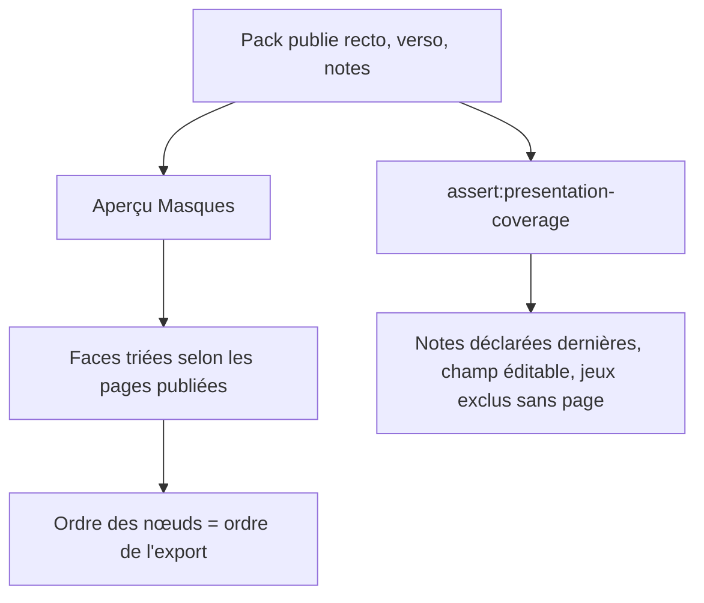
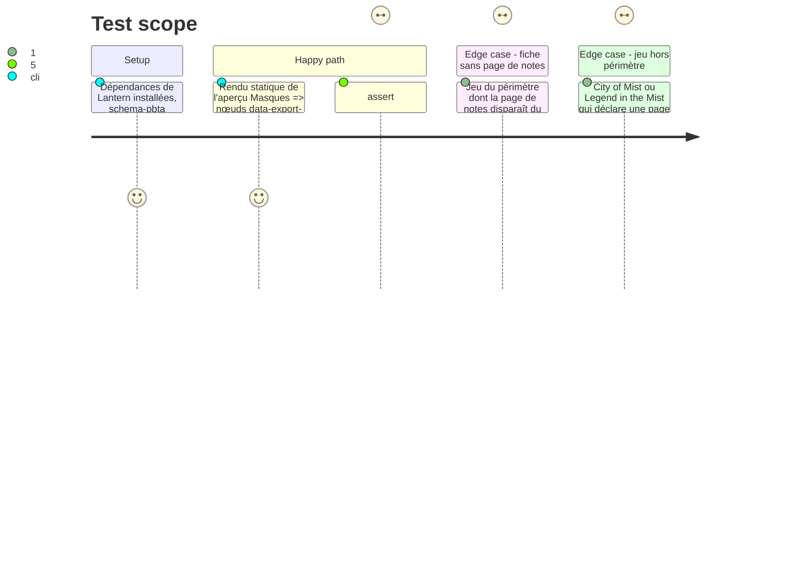

<!-- Fill or omit these sections; never add, rename, or reorder one. -->

# Instruction: Lantern : ordre des faces Masques et contrôle des notes

Issues : lantern#78 et #79.

## Architecture projection

> Tree of the final files. ✅ create · ✏️ modify · ❌ delete

```txt
lantern/
├── src/templates/masks/playbook/preview/MasksPlaybookPreview.tsx  ✏️ les faces se dessinent dans l'ordre des pages publiées (`playbookPages('masks-playbook')`), la page de notes restant après
├── src/templates/the-sprawl/playbook/preview/SprawlPlaybookPreview.tsx, src/templates/urban-shadows/playbook/preview/UrbanShadowsPlaybookPreview.tsx  ✏️ seulement si leur ordre d'apparition diffère de l'ordre publié
├── tools/assert-presentation-coverage.mjs                         ✏️ contrôle des notes : page de notes dernière et déclarée, champ éditable, absente de City of Mist et Legend in the Mist
└── tools/assertExportPages.harness.mts                            ✏️ l'ordre des nœuds `data-export-page` de l'aperçu égale l'ordre déclaré, pour chaque modèle qui déclare des pages
```

## User Journey



## Test Scope



## Tasks to do

### `1)` Ordre des faces de l'aperçu Masques (#78)

> L'aperçu montre ce que l'export produit.

1. Trier `presentation.faces` selon l'indice de leur `id` dans `playbookPages('masks-playbook')` avant le rendu ; une face absente des pages garde sa place à la fin.
2. Vérifier The Sprawl (contrat `recto`, `verso`) et Urban Shadows (aperçu qui regroupe ses faces dans l'ordre d'apparition de ses régions) : corriger l'ordre de chacun si l'ordre d'apparition diffère de l'ordre publié ; les autres aperçus (Adrenaline PJ, Otherscape, Monsterhearts, `playbook`) dessinent déjà leurs pages dans l'ordre déclaré.
3. Étendre le harnais d'export pour que l'ordre des nœuds de l'aperçu égale l'ordre déclaré, pour chaque modèle qui déclare des pages (le harnais compare aujourd'hui les ensembles triés). Pour un aperçu qui exige le DOM (`needsDom`), l'ordre se constate au navigateur en phase 3.

### `2)` Contrôle des notes (#79)

> Une fiche qui perd ses notes fait échouer la couverture.

1. Pour chaque cible du périmètre (Adrenaline PJ, Otherscape personnage, livrets PbtA), lire les pages publiées ; exiger une seule page de notes, dernière, dont le champ est celui que l'éditeur écrit.
2. Pour City of Mist et Legend in the Mist, exiger qu'aucune page de notes n'existe.
3. La liste des cibles et les noms de champs se lisent des paquets publiés (`getPbtaPlaybookPages`, pages d'Adrenaline et d'Otherscape), jamais recopiés.

### `3)` Livraison

> Les changements de Lantern ne sont pas livrés tant qu'un train ne les a pas portés.

1. Après la phase 1 (le superviseur corrigé, commité et poussé), poser un train du superviseur pour Lantern (`pnpm supervise` : plan de train, `present`, preview si un rendu change, `ship --run`) ; la version et le `CHANGELOG` de Lantern se préparent avec le changement. Le rendu des aperçus changeant, le verdict de rendu de l'utilisateur est demandé après le preview, pas avant.

## Test acceptance criteria

| Task | Acceptance criteria |
| ---- | ------------------- |
| 1 | L'aperçu Masques dessine recto, verso, puis la page de notes ; l'ordre des nœuds égale celui de l'export. |
| 2 | `assert:presentation-coverage` échoue en nommant la fiche quand une page de notes manque, n'est pas dernière ou apparaît sur un jeu hors périmètre, et passe sur l'état courant ; `npm run check` de Lantern est vert. |
| 3 | Un train de Lantern est publié avec ces changements, version et `CHANGELOG` alignés, verdict de rendu de l'utilisateur obtenu. |
