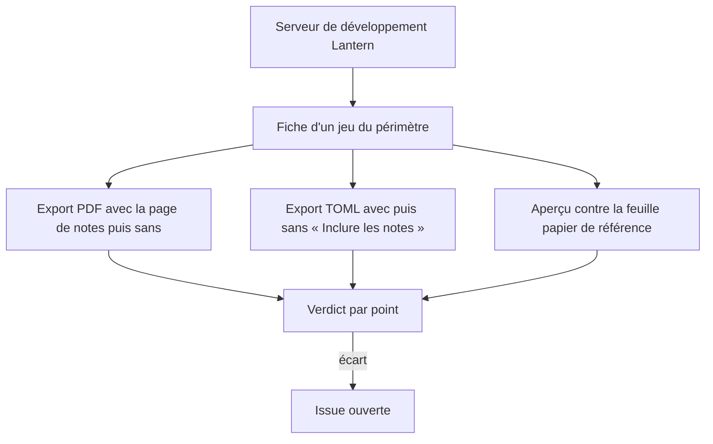
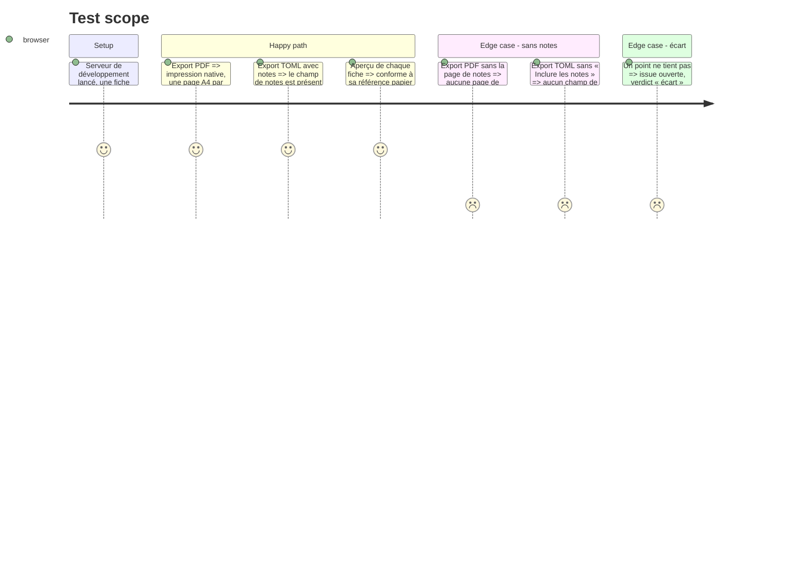

<!-- Fill or omit these sections; never add, rename, or reorder one. -->

# Instruction: Lantern : export PDF, TOML et feuilles papier, constatés

Issue : lantern#80. Constat dans le navigateur ; aucun code attendu sauf si un écart est corrigé (il devient alors une issue, hors de ce plan).

## Architecture projection

> Tree of the final files. ✅ create · ✏️ modify · ❌ delete

```txt
obsidian-handbook/
└── aidd_docs/tasks/2026_11/2026_11_20_notes-de-partie-suites/
    └── verdicts.md   ✅ un verdict par point constaté (export PDF, TOML, comparaison à chaque feuille papier)
```

## User Journey



## Test Scope



## Tasks to do

### `1)` Export PDF

> Ce que l'utilisateur obtient en choisissant PDF.

1. Sur chaque jeu du périmètre : lancer l'export PDF avec la page de notes, puis sans ; vérifier le nombre de pages, l'ordre, la taille A4, une `@page` nommée par page, le texte sélectionnable.
2. Noter le verdict de chaque jeu dans `verdicts.md`.

### `2)` Export TOML

> Les notes partent, ou ne partent pas, selon la case.

1. Exporter le TOML avec « Inclure les notes » puis sans ; comparer les deux : seul le champ de notes diffère.
2. Réimporter le TOML avec notes : le texte revient dans la page de notes.

### `3)` Feuilles papier

> Chaque fiche est comparée à sa référence.

1. Comparer l'aperçu de chaque fiche à la feuille papier de référence du plan d'origine ; la référence se nomme dans le verdict.
2. Tout écart devient une issue ; le plan ne corrige pas en passant.

## Test acceptance criteria

| Task | Acceptance criteria |
| ---- | ------------------- |
| 1 | `verdicts.md` porte un verdict d'export PDF, avec et sans page de notes, pour chaque jeu du périmètre. |
| 2 | `verdicts.md` porte un verdict TOML avec et sans notes, et la réimportation. |
| 3 | `verdicts.md` porte un verdict par fiche contre sa référence papier ; chaque écart renvoie à une issue. |
