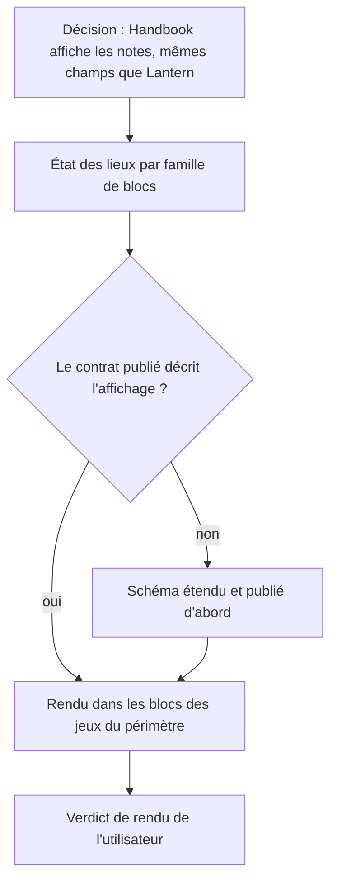
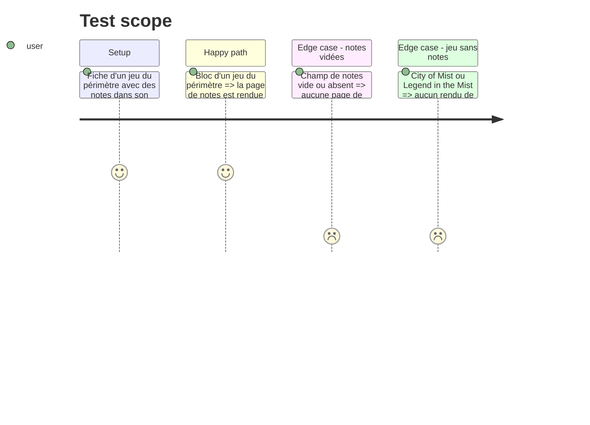

<!-- Fill or omit these sections; never add, rename, or reorder one. -->

# Instruction: Handbook : affichage des notes de partie dans les blocs

Issue : obsidian-handbook#137. **Décision de l'utilisateur (2026-11-20) : oui, Handbook affiche les notes de partie, avec les mêmes champs que Lantern** (`notesDePartie` pour Adrenaline, `session_notes` pour Otherscape, `sessionNotes` pour les livrets PbtA). Il ajoute qu'en fin de séance le joueur récupère la fiche et peut en stocker le contenu puis le vider pour la séance suivante, ou le résumer. Lecture retenue : c'est la façon dont le joueur manie le texte (il l'édite, dans Lantern ou dans la note), pas une fonction à bâtir ; aucune action « archiver » ou « vider » n'est prévue. À corriger si l'utilisateur la voulait en fonction.

## Architecture projection

> Tree of the final files. ✅ create · ✏️ modify · ❌ delete

```txt
obsidian-handbook/
└── src/features/                 ✏️ si la réponse est « oui » : les familles de blocs concernées rendent le champ de notes ; si « non » : rien ne change
```

## User Journey



## Test Scope



## Tasks to do

### `1)` Poser la forme du rendu

> Le « oui » est acquis ; reste la forme, qui se montre avant de se livrer.

1. Établir l'état des lieux : Adrenaline PJ tolère le champ sans le dessiner (`src/features/adrenalinePj/schema.ts`) ; chercher ce que font Otherscape et les livrets PbtA du champ de leur document.
2. Lire dans les paquets publiés ce que le contrat dit de l'affichage (page de notes, capacité, libellés, polices) ; ne rien deviner côté consommateur.
3. Si le schéma ne décrit pas assez l'affichage, l'étendre et le publier avant tout travail Handbook (flux inter-dépôts).

**État des lieux (constaté le 2026-11-20, tâches 1.1 et 1.2).**

| Famille | Aujourd'hui dans Handbook | Ce que le contrat publié dit |
| ------- | ------------------------- | ---------------------------- |
| Adrenaline PJ (`src/features/adrenalinePj/`) | `notesDePartie` est lu et conservé dans le TOML copié, **jamais dessiné** (`schema.ts:65`) | `PJ_PRESENTATION.pages` : la page de notes porte `notesPath` (pointeur JSON du texte), dernière page |
| Otherscape personnage (`src/features/osCharacter/`) | `schema.ts` ne lit ni ne conserve `session_notes` : un document qui le porte le perd à la réécriture | `OTHERSCAPE_CHARACTER_PAGES` : page `notes` avec `notes_field: "session_notes"`, dernière |
| Livrets PbtA (`src/features/pbta/`) | aucune trace de `sessionNotes` | `getPbtaPlaybookPages(target)` : page avec `notes_field`, dernière ; `sessionNotes` borné par `SESSION_NOTES_CAPACITY` dans le schéma Zod du livret |

Le contrat publie **quelle page, quel champ, quelle capacité, quels libellés (fr/en)** ; il ne décrit pas le **dessin** de la page (cadre, lignes, police) : celui-ci vit dans le composant `NotesPage` de Lantern. Deux constats pour la suite : (a) la page de notes se rend à partir de ces données publiées, sans repli local ; (b) le dessin lui-même est une décision de design à valider par le rendu, pas un contrat à étendre d'avance. Si le verdict de rendu demande un habillage partagé par Lantern et Handbook, il passe par le schéma avant tout code consommateur. Le travail de code (tâche 2) et le train de livraison restent à faire.

### `2)` Rendre les notes

> Mêmes champs que Lantern, aucun repli sémantique local.

1. Rendre le champ de notes dans les familles de blocs des jeux du périmètre, sous forme de page de notes à la suite de la fiche, selon la présentation publiée ; rien pour City of Mist ni Legend in the Mist.
2. Un champ vide ne dessine rien (le joueur qui vide ses notes pour la séance suivante ne voit pas de cadre vide gênant), et un texte résumé se rend comme n'importe quel texte de notes.
3. Train du superviseur, puis verdict de rendu de l'utilisateur après le preview ; la référence de rendu est la page de notes de Lantern.

**Réalisé (2026-11-20, tâches 2.1 et 2.2 ; le train et le verdict de rendu de 2.3 restent à faire).** Une fonction commune `renderSessionNotes` (`src/features/blocks/sessionNotes.ts`) dessine la page : un cadre à saut de page avant (`src/styles/_session-notes.scss`), le libellé français publié en titre, le texte tel que saisi (retours à la ligne conservés). Elle est appelée **en dernier** par les trois familles : Adrenaline PJ (`PJ_PRESENTATION.pages[].notesPath`), Otherscape personnage (`OTHERSCAPE_CHARACTER_PAGES`, champ `session_notes`, désormais lu **et réécrit** dans le TOML) et livrets PbtA (`getPbtaPlaybookPages(target)`, `notes_field`), y compris quand un pack dessine lui-même le livret (Masques, Monsterhearts, Sprawl, Urban Shadows). Un texte absent, vide ou fait de blancs ne dessine rien. Preuve : `pnpm assert:session-notes` (témoins publiés par les trois producteurs ; échoue si les notes PbtA ne sont plus rendues, constaté) ; il affirme aussi qu'aucun fichier hors des trois familles n'importe `sessionNotes`, donc rien pour City of Mist ni Legend in the Mist.

## Test acceptance criteria

| Task | Acceptance criteria |
| ---- | ------------------- |
| 1 | L'état des lieux de chaque famille de blocs est écrit, et le contrat publié suffit à l'affichage, sinon il est étendu et publié d'abord. |
| 2 | Un bloc de chaque jeu du périmètre rend ses notes avec les mêmes champs que Lantern ; un champ vide ne dessine rien ; aucun bloc de City of Mist ni de Legend in the Mist n'en rend ; l'utilisateur valide le rendu. |
