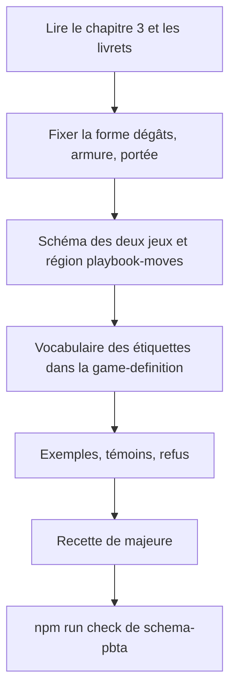
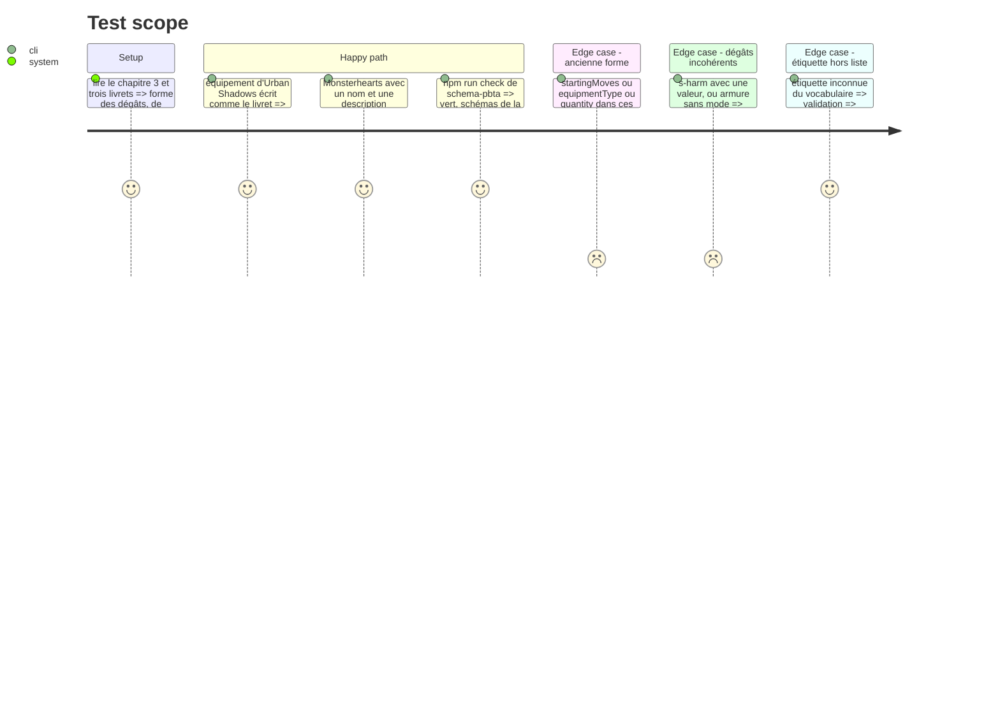

# Instruction: Fixer la forme conforme aux règles et publier le contrat (schema-pbta)

## Architecture projection

```txt
../schema-pbta/
├── src/zod/urban-shadows-playbook.ts ✏️ omit startingMoves et gear du livret générique ; nouvelle forme d'équipement
├── src/zod/monsterhearts-playbook.ts ✏️ omit startingMoves ; gear réduit à name et description
├── src/presentation/urban-shadows-playbook.ts ✏️ clé `equipment` : portées et vocabulaire des étiquettes (livré dans le contrat de présentation, pas dans la game-definition)
├── src/presentation/urban-shadows-playbook.ts ✏️ région playbook-moves sans startingMoves
├── src/presentation/monsterhearts-playbook.ts ✏️ région playbook-moves sans startingMoves
├── packs/urban-shadows/presentation-contract.json ✏️ généré
├── packs/monsterhearts/presentation-contract.json ✏️ généré
├── examples/urban-shadows/ ✏️ the-aware.toml, l-eveille.toml : équipement de départ écrit comme le livret ; game-definition : vocabulaire
├── examples/monsterhearts/ ✏️ la-selkie.toml : équipement nom et description s'il y en a
├── corpus/temoins/ ✏️ équipement conforme (Urban Shadows) ; Monsterhearts sans startingMoves
├── corpus/refus/ ✅ startingMoves refusé, equipmentType et quantity refusés, s-harm avec valeur, armure sans mode
├── schemas/v<N+1>/ ✅ généré (la version courante reste figée)
├── tools/validate-version-compat.ts ✏️ archivedVersions : ajouter la version courante
├── src/contract-version.ts, package.json, packs/*/pack-contract.json, cross-tool-provider.json, docs/compatibility.md ✏️ recette de majeure (reprendre la liste exacte dans la dernière majeure du CHANGELOG)
└── CHANGELOG.md ✏️ changement cassant, sans chemin de lecture de l'ancienne forme
```

`tools/validate-references.ts` garde son contrôle de `startingMoves` : les autres jeux le portent encore.

## User Journey



## Test Scope



## Tasks to do

### `0)` Fixer la forme contre le livre

> Le ticket donne le sens ; le livre donne la forme.

1. Lire en entier le chapitre 3 du livre de base d'Urban Shadows (« Armor », « Stun harm », « Fictional tags », tableau des étiquettes) et l'équipement de départ de trois livrets (`US-Playbooks-web20241126.pdf`, dont The Aware).
2. Lire le volume 1 de Monsterhearts : confirmer qu'aucun playbook n'imprime de liste d'équipement et que le fétiche de la Sorcière est le seul objet à règle.
3. Inscrire au Decisions du plan la forme retenue des champs de dégâts, d'armure et de portée (structure ou champs plats) et la liste exacte des étiquettes publiées.

### `1)` Schéma et contrat de présentation

1. Urban Shadows : `playbookSchema.omit({ startingMoves, gear })` puis un schéma d'équipement propre (nom requis ; description, dégâts, armure, portée, étiquettes facultatifs ; aucun `equipmentType` ni `quantity`). Dégâts entiers ou étourdissants ; armure valeur et mode ; portée parmi `hand`, `close`, `near`, `far`.
2. Monsterhearts : `omit({ startingMoves, gear })` puis `gear` en liste de `{ name, description? }`.
3. Retirer `startingMoves` de la région `playbook-moves` des deux contrats de présentation ; régénérer `packs/*/presentation-contract.json`.
4. Game-definition d'Urban Shadows : vocabulaire facultatif des étiquettes d'équipement (clé publiée, libellés `fr` et `en`), sur le modèle de `equipmentTypes` (`labelDictionary`) ; le schéma d'équipement n'en fait pas une énumération. Si `validate-references` ou une région du contrat de présentation doit nommer cette clé, l'y inscrire (le menu de Lantern en dépend).

### `2)` Exemples, témoins, refus

1. Écrire l'équipement de départ de The Aware et de L'Éveillé comme le livret : prose en noms nus, arme en forme normale. `examples/` n'en porte aucun aujourd'hui ; les témoins non plus.
2. Témoins du corpus : un équipement d'Urban Shadows complet (arme, armure, prose) ; un Monsterhearts avec équipement nom et description.
3. Refus : les quatre cas du Test Scope (ancienne forme, `s-harm` avec valeur, armure sans mode, `startingMoves`). Les deux moitiés sont nécessaires.

### `3)` Majeure et vérification

1. Appliquer la recette de la majeure précédente ; générer `schemas/v<N+1>` ; ajouter la version courante à `archivedVersions`.
2. Changelog : changement cassant, champs retirés, aucune lecture de l'ancienne forme, conséquence pour une action écrite en `{ ref }` sans `checked`.
3. `npm run check` de schema-pbta (restaurer les fichiers réécrits en LF dont `git diff --ignore-cr-at-eol` est vide).

## Test acceptance criteria

| Task | Acceptance criteria |
| ---- | ------------------- |
| 0 | Le tableau Decisions du plan porte la forme des dégâts, de l'armure, de la portée et la liste des étiquettes, chacune tirée du livre ; le constat Monsterhearts est écrit. |
| 1 | Un TOML Urban Shadows écrit comme le livret passe la validation ; `startingMoves`, `equipmentType` et `quantity` sont refusés pour ces deux jeux ; Masks, The Sprawl et le livret générique valident toujours leur forme générique. |
| 2 | Les exemples et témoins valident ; chaque cas de refus est rejeté avec un message qui nomme le champ. |
| 3 | `npm run check` de schema-pbta vert ; `validate:version` confirme les schémas précédents octet pour octet ; la région `playbook-moves` ne liste plus `startingMoves` pour ces deux jeux. |
