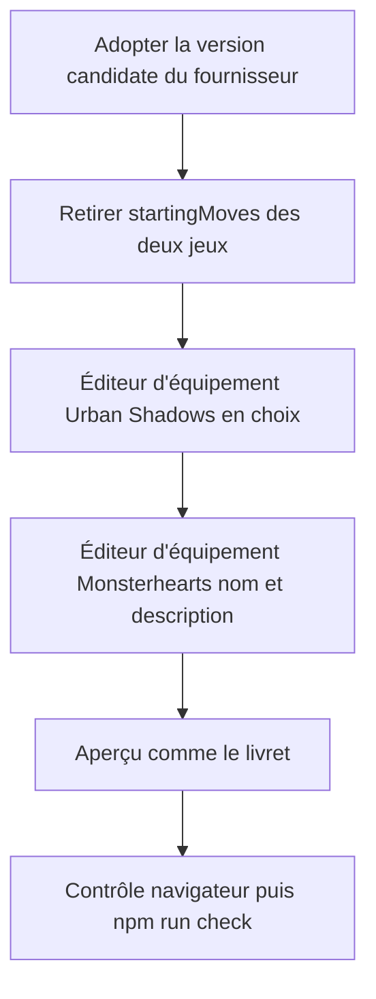
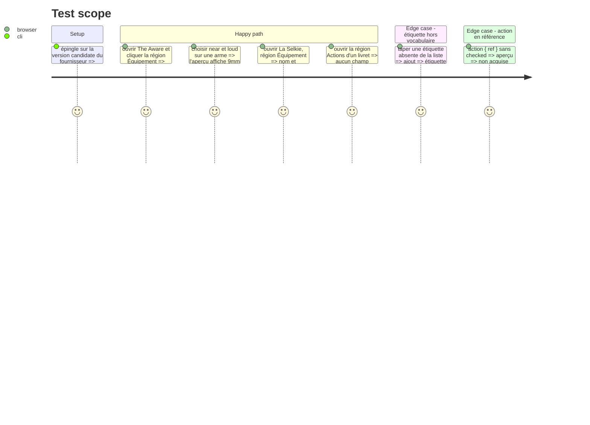

# Instruction: Lantern : éditeurs en choix, aperçu comme le livret

## Architecture projection

```txt
../lantern/
├── src/templates/urban-shadows/playbook/model.ts ✏️ plus de startingMoves
├── src/templates/urban-shadows/playbook/editor/UrbanShadowsPlaybookEditorPanel.tsx ✏️ descripteur gear : nom, description, dégâts, armure, portée (choix), étiquettes (choix du vocabulaire publié, ajout libre) ; plus de startingMoves
├── src/templates/urban-shadows/playbook/preview/UrbanShadowsPlaybookPreview.tsx ✏️ équipement écrit comme le livret ; acquisition par moves[].checked seul
├── src/templates/urban-shadows/playbook/sample.ts ✏️ équipement de départ écrit comme le livret (fr et en selon la langue)
├── src/templates/monsterhearts/playbook/editor/MonsterheartsPlaybookEditorPanel.tsx ✏️ gear : nom et description ; plus de startingMoves
├── src/templates/monsterhearts/playbook/preview/MonsterheartsPlaybookPreview.tsx ✏️ équipement nom et description ; acquisition par moves[].checked seul
├── src/templates/pbta/specialized/descriptorFactories.ts ✏️ au besoin, une fabrique de liste de choix issue d'un vocabulaire publié
├── src/i18n/locales/{en,fr}/pbta.ts ✏️ libellés des champs d'équipement (français d'abord) ; retrait de celui de startingMoves
├── package.json, package-lock.json ✏️ épingle de producteur
└── CHANGELOG.md ✏️
```

## User Journey



## Test Scope



## Tasks to do

### `1)` Adopter le contrat

> Les menus sortent des métadonnées publiées, aucun repli local.

1. Épingler le fournisseur sur sa version candidate (comme le fait le superviseur) ; ne jamais recopier un numéro de version ailleurs que dans l'épingle.
2. Lire le vocabulaire des étiquettes dans la game-definition publiée ; ne coder aucune liste d'étiquettes dans Lantern.

### `2)` Retirer `startingMoves` et refaire l'équipement

1. Supprimer `startingMoves` des modèles, descripteurs et panneaux d'Urban Shadows et de Monsterhearts, et le `PublishedFields fields={['startingMoves']}` du panneau Monsterhearts.
2. Urban Shadows : descripteur d'équipement à la forme fixée en phase 1 ; portée en choix parmi les quatre valeurs publiées, étiquettes en choix du vocabulaire avec ajout libre ; panneau court (un clic ouvre les champs de la zone, sans défilement).
3. Monsterhearts : descripteur d'équipement `name` + `description`.
4. Aperçus : l'équipement s'écrit comme le livret ; l'acquisition d'une action ne lit plus que `moves[].checked`.
5. Libellés dans `fr` et `en` (français d'abord) ; aucune chaîne en dur dans les éditeurs ; `sample.ts` fournit l'exemple dans la langue de l'interface, jamais mêlée dans une fiche.

### `3)` Vérifier

1. Contrôle au navigateur : serveur de Lantern, Urban Shadows puis Monsterhearts, chaque cas du Test Scope.
2. `npm run typecheck`, `npm run lint`, `npm run check:project` (dont `assert:editor-literals` et `assert:workspace`).

## Test acceptance criteria

| Task | Acceptance criteria |
| ---- | ------------------- |
| 1 | Lantern lit les contrats et le vocabulaire de la version candidate ; aucune liste d'étiquettes ni de portées n'est écrite dans `src/`. |
| 2 | Aucun champ « Actions de départ », « Type d'équipement » ni « Quantité » pour ces deux jeux ; une arme se saisit par choix et s'affiche comme le livret ; un TOML exporté valide contre le schéma de la nouvelle majeure. |
| 3 | Les trois gardes de Lantern sont vertes ; chaque cas du Test Scope est constaté au navigateur. |
