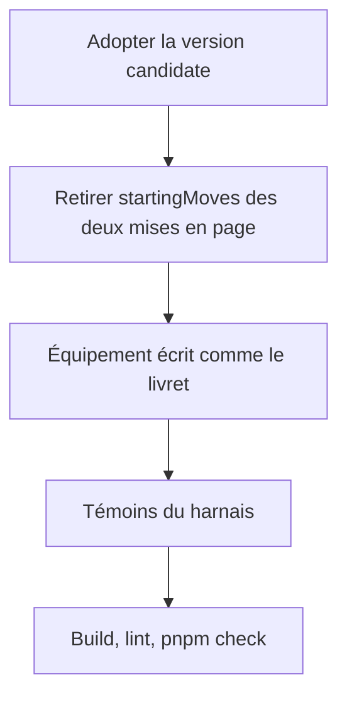
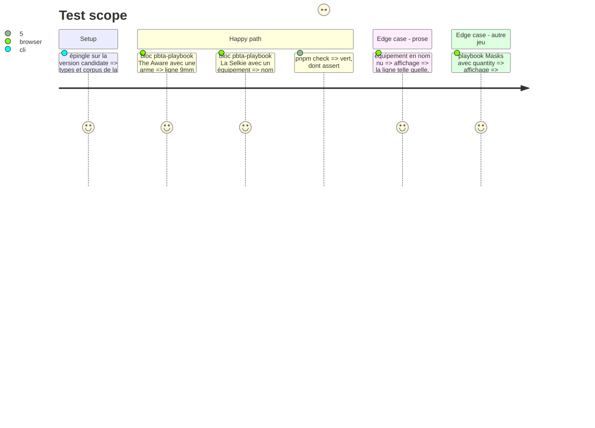

# Instruction: Handbook : afficher l'équipement comme le livret

## Architecture projection

```txt
.
├── src/features/pbta/urbanShadowsLayout.ts ✏️ équipement écrit comme le livret ; acquisition par moves[].checked seul
├── src/features/pbta/monsterheartsLayout.ts ✏️ équipement nom et description ; acquisition par moves[].checked seul
├── src/features/pbta/renderer.ts ✏️ le rendu générique (autres jeux) garde sa forme ; ne lire quantity que pour eux
├── src/features/pbta/types.ts ✏️ types des données selon la nouvelle majeure (au besoin)
├── tools/pbtaPlaybookStyles.harness.mts ✏️ compléments du témoin si une région ou un crochet apparaît
├── package.json, pnpm-lock.yaml ✏️ épingle de producteur
└── CHANGELOG.md ✏️
```

## User Journey



## Test Scope



## Tasks to do

### `1)` Adopter et retirer

1. Épingler le fournisseur sur sa version candidate ; les versions se lisent dans `package.json`, jamais recopiées.
2. Retirer `startingMoves` de `urbanShadowsLayout.ts` et de `monsterheartsLayout.ts` : `acquired` ne lit plus que `move.checked`.

### `2)` Afficher comme le livret

1. Urban Shadows : une ligne par pièce d'équipement : nom, puis tiret, dégâts, portée et étiquettes ; armure écrite `x-armor` ou `armor+x` ; un nom nu s'affiche seul. Termes de jeu non traduits.
2. Monsterhearts : nom, tiret, description.
3. Le rendu générique de `renderer.ts` (Masks, The Sprawl…) garde `quantity` et ne change pas.
4. Si une région ou un crochet nouveau apparaît, compléter le témoin de `tools/pbtaPlaybookStyles.harness.mts` (le harnais exige que le témoin porte chaque crochet que `playbook.css` cible).

### `3)` Vérifier

1. `rtk proxy pnpm build`, `pnpm lint` et `./node_modules/.bin/eslint src --ext .ts` à zéro erreur ; `pnpm check` vert.
2. Rendu dans Obsidian sur les deux jeux (`doc` : coffre de test) ; export PDF de La Selkie inchangé si `playbook.css` n'a pas bougé.

## Test acceptance criteria

| Task | Acceptance criteria |
| ---- | ------------------- |
| 1 | Plus aucune lecture de `startingMoves` dans les deux mises en page ; l'épingle vient du fournisseur candidat. |
| 2 | L'équipement d'Urban Shadows se lit comme le livret ; celui de Monsterhearts est nom et description ; Masks et The Sprawl s'affichent comme avant. |
| 3 | Build, les deux portées de lint et `pnpm check` verts ; rendu constaté dans Obsidian. |
