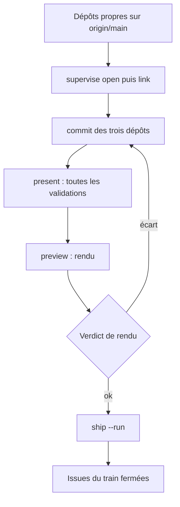

# Instruction: Présenter, valider le rendu et livrer

## Architecture projection

```txt
supervisor/trains/pbta-gear-starting-moves.json ✅ fichier de train (non commité, comme les trains précédents)
aidd_docs/tasks/2026_11/2026_11_24_pbta-gear-starting-moves/ ✏️ statuts des phases et du plan
```

Le superviseur écrit lui-même les commits des trois dépôts (message dans `<git-dir>/SUPERVISOR_COMMIT_MSG`, en anglais, terminé par `Closes #N`).

## User Journey



## Test Scope

```mermaid
---
title: Test scope
---
journey
  section Setup
    dépôts propres sur origin/main et train précédent livré => open possible: 5: cli
  section Happy path
    present => toutes les validations vertes, consommateurs mesurés sur le paquet du fournisseur: 5: cli
    preview => The Aware et La Selkie rendus dans les deux outils, équipement comme le livret: 5: browser
    verdict de l'utilisateur => rendu ok: 5: system
    ship --run => fournisseur, Lantern et Handbook publiés: 5: cli
  section Edge case - épingle locale
    épingle file: dans un consommateur => present => refus pin-invalid: 1: cli
  section Teardown
    issues du train => fermées, schema-pbta#51 close avec renvoi au train: 5: cli
```

## Tasks to do

### `1)` Avant le départ

1. Vérifier que le train précédent est livré et que les trois dépôts sont propres sur `origin/main`.
2. Cible de rendu nommée : le livret d'Urban Shadows (équipement de départ d'au moins un livret : prose et arme) et le PDF de La Selkie. Poser les points de contrôle avant le rendu : (a) une arme se lit `nom — dégâts portée étiquettes`, (b) une ligne de prose s'affiche seule, (c) aucune « Action de départ » ni « Quantité » nulle part, (d) La Selkie : équipement nom et description, mise en page inchangée.
3. Les consommateurs gardent l'épingle de la version publiée (asset de release) ; jamais un `file:` au moment de `commit` et de `present`.

### `2)` Train

1. `pnpm supervise open`, `link`, `next`, `commit`, `present`, `preview` ; toute validation se joue dans `present`, aucune après.
2. Recueillir le verdict de rendu (seul point demandé à l'utilisateur) ; au plus deux cycles de correction, ensuite retour à l'utilisateur.
3. `pnpm supervise ship --run` ; lire le journal complet (`Whole output:`) en cas d'échec, jamais la fin de sortie.

### `3)` Clôture

1. Vérifier les versions publiées (fournisseur, Lantern, Handbook) et la fermeture des issues du train ; fermer schema-pbta#51 avec un renvoi à l'issue de coordination.
2. Passer les phases à `done` et le plan à `implemented` seulement après cette vérification ; écrire la reprise en mémoire.

## Test acceptance criteria

| Task | Acceptance criteria |
| ---- | ------------------- |
| 1 | Les points de contrôle (a) à (d) sont écrits avant le rendu ; aucun dépôt sale, aucune épingle `file:`. |
| 2 | `present` est vert ; le verdict de rendu est inscrit ; `ship --run` se termine sans accident. |
| 3 | Les trois versions sont publiées, les issues du train fermées, schema-pbta#51 fermée ; statuts mis à jour. |
