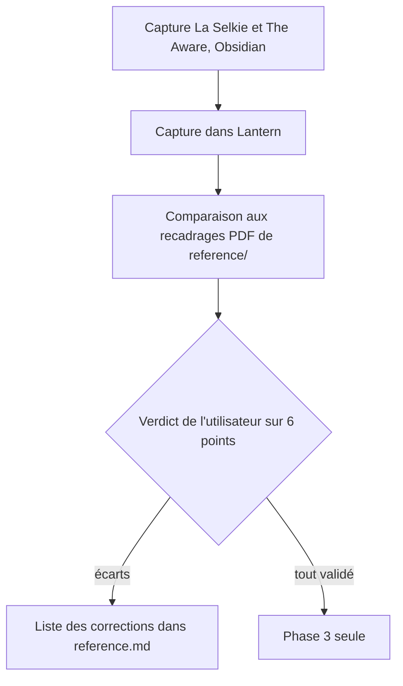
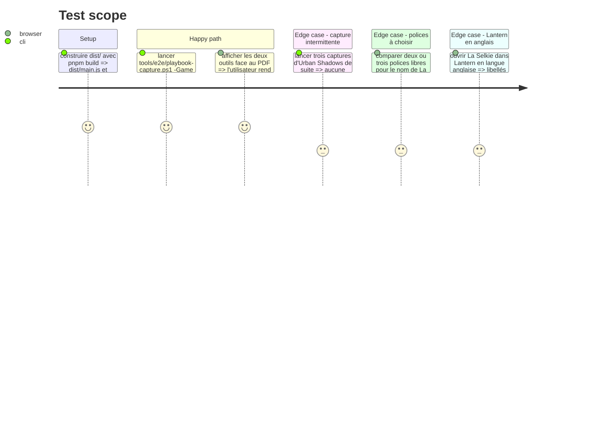

# Instruction: Relever l'état de rendu et le verdict de l'utilisateur

## Architecture projection

```txt
aidd_docs/tasks/2026_11/2026_11_09_pbta-playbook-shared-styles/
├── reference.md ✏️ colonne « verdict » par point de contrôle, jeu et outil ; liste des écarts à corriger
└── reference/ ✏️ captures du rendu actuel (ignorées par git)
```

## User Journey



## Test Scope



## Tasks to do

### `1)` Capturer l'état actuel

> Partir du rendu réellement livré, pas de celui du 2026-11-09.

0. Corriger d'abord `tools/e2e/playbook-capture-cdp.py` (écart 3 : capture d'Urban Shadows échouant par intermittence, boîte mesurée avant la mise en page) : attendre la mise en page (`document.fonts.ready` puis deux `requestAnimationFrame`) avant de mesurer, et relancer trois captures de suite sans échec.
1. `rtk proxy pnpm build`, puis `pwsh tools/e2e/playbook-capture.ps1 -Game all -SchemaRoot ../schema-pbta` (paquet épinglé à jour dans le coffre temporaire).
2. Capturer La Selkie et The Aware dans Lantern, lancé en local.
3. Ranger les captures dans `reference/` à côté des recadrages PDF.

### `2)` Obtenir le verdict

> Le verdict est à l'utilisateur ; il fixe ce que les phases 2 et 3 corrigent.

1. Présenter, par jeu et par outil, les trois points de contrôle de `reference.md` face au PDF.
2. Consigner chaque écart annoncé dans `reference.md` (§ Verdict) : région, outil, rendu attendu.
3. Constater aussi l'export PDF actuel de La Selkie, sans le corriger (phase 3).
4. Faire trancher par l'utilisateur les deux choix de police en suspens : le nom de La Selkie (écart 2 : `IM Fell Double Pica` italique ou un script libre) et les titres et étiquettes de `stat-spread` / `circle-status` d'Urban Shadows (écart 9 : pinceau penché à pointes, sans-serif gras). Présenter pour chacun deux ou trois candidates sous licence libre déjà publiables, rendues côte à côte ; consigner le choix.

## Test acceptance criteria

| Task | Acceptance criteria |
| ---- | -------------------- |
| 1 | Une capture par jeu et par outil existe dans `reference/`, avec le Handbook et le paquet courants. |
| 2 | `reference.md` porte un verdict par point de contrôle, jeu et outil, et la liste des écarts à corriger (éventuellement vide), polices comprises : les écarts 2 et 9 y portent le choix de l'utilisateur. |
| 3 (outillage) | Trois captures d'Urban Shadows de suite aboutissent, sans « Cannot take screenshot with 0 width ». |
