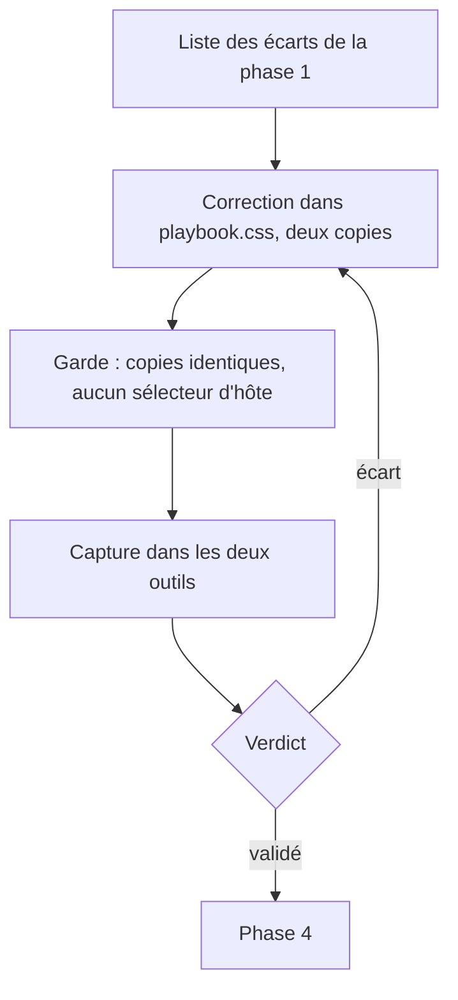
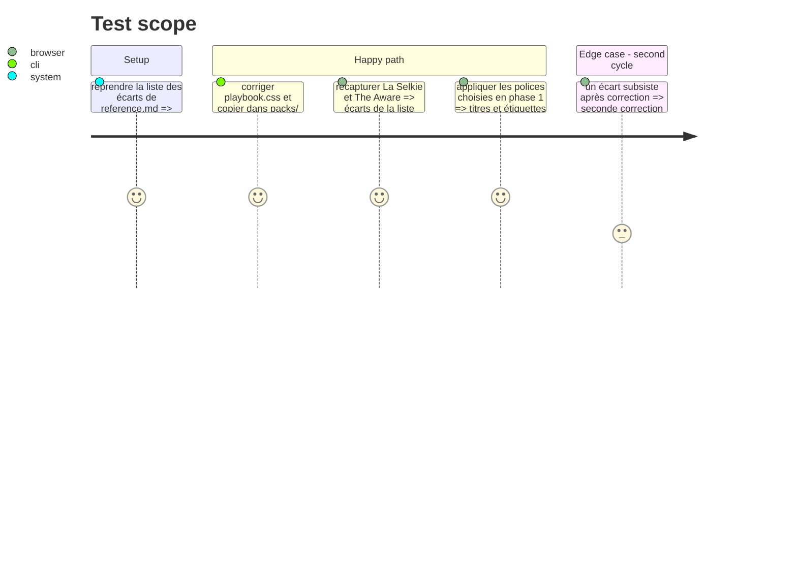

# Instruction: Corriger `playbook.css` dans schema-pbta

## Architecture projection

```txt
../schema-pbta/
├── handbook/monsterhearts/assets/styles/playbook.css ✏️ écarts relevés (Monsterhearts)
├── packs/monsterhearts/assets/styles/playbook.css ✏️ copie octet pour octet
├── handbook/urban-shadows/assets/styles/playbook.css ✏️ écarts relevés (Urban Shadows)
└── packs/urban-shadows/assets/styles/playbook.css ✏️ copie octet pour octet
```

Seuls les fichiers dont un écart est relevé en phase 1 changent. Si la police choisie en phase 1 n'est pas déjà publiée (écarts 2 et 9), son WOFF2 entre aussi dans `handbook/<jeu>/assets/fonts/` avec sa licence OFL, sa déclaration dans `faces.css` et le contrat d'apparence du pack ; la garde des polices de `npm run check` (schema-pbta) doit rester verte.

## User Journey



## Test Scope



## Tasks to do

### `1)` Corriger la source

> Une valeur, un fichier, deux copies identiques.

1. Pour chaque écart de la liste, modifier `handbook/<jeu>/assets/styles/playbook.css` puis recopier vers `packs/<jeu>/…`.
2. Ne rien écrire de propre à un hôte (`body`, `.brumes--*`, `.theme-*`, variables d'Obsidian) ; garder les jetons à repli `var(--<jeu>-*, <valeur du PDF>)`.
3. Appliquer les choix de police de la phase 1 (écarts 2 et 9) et le décollement du nom de La Selkie (écart 1, marge au-dessus de `.handbook-monsterhearts-portrait-name`).
4. `npm run check` dans schema-pbta (restaurer les fichiers réécrits en LF dont `git diff --ignore-cr-at-eol` est vide).

### `2)` Prouver le rendu

> Au plus deux cycles de correction ; au-delà, revenir à l'utilisateur.

1. Reprendre `playbook-capture.ps1` avec le CSS corrigé (`-SchemaRoot ../schema-pbta`).
2. Vérifier dans Lantern avec l'import du paquet corrigé.

## Test acceptance criteria

| Task | Acceptance criteria |
| ---- | -------------------- |
| 1 | La garde de schema-pbta passe : copies identiques, aucun sélecteur ni variable d'hôte. |
| 2 | Chaque écart de la liste est absent des captures Obsidian et Lantern ; sinon l'utilisateur est revenu dans le cycle. |
