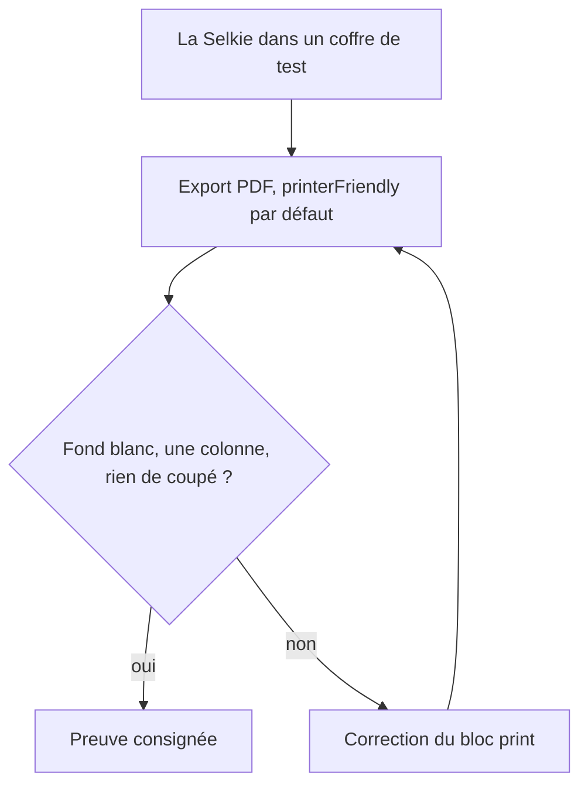
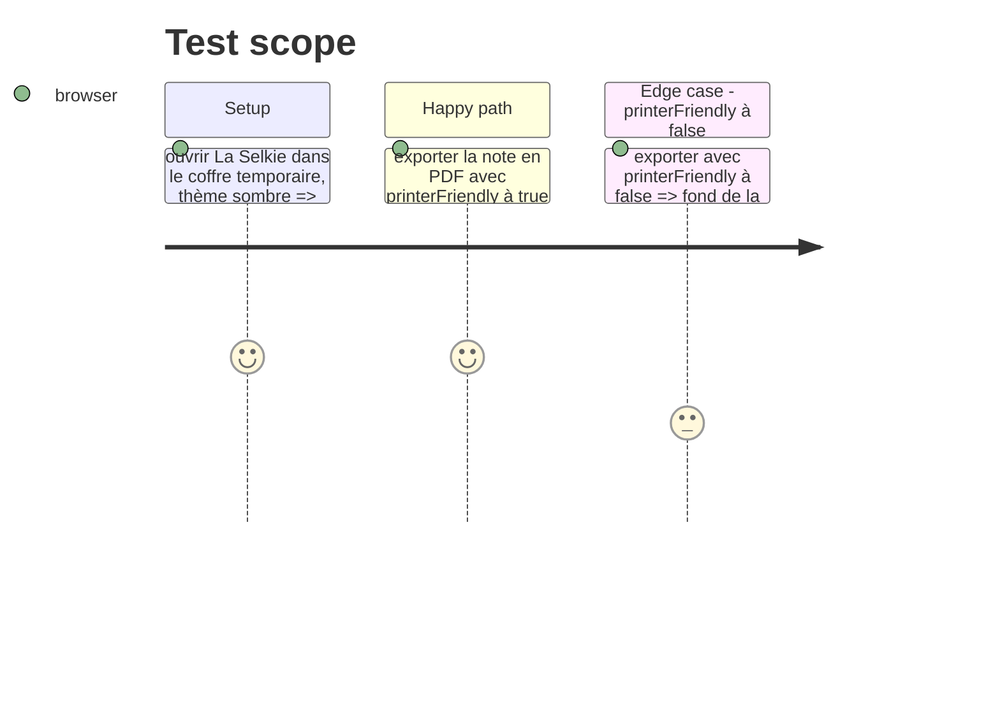

# Instruction: Prouver l'export PDF de La Selkie sur papier blanc

> **Se joue après la phase 4** (ordre 1, 2, 4, 3, 5, 6) : le verso change l'export, la preuve porte sur la fiche livrée, recto et verso.

## Architecture projection

```txt
../schema-pbta/packs/monsterhearts/assets/styles/playbook.css ✏️ bloc @media print, seulement si l'export le révèle fautif
src/styles/_print.scss ✏️ seulement si le fond de page n'est pas blanc
tools/e2e/ ✅ capture d'impression de La Selkie, ou assertion de assert:style-scope (à décider selon l'export)
```

## User Journey



## Test Scope



## Tasks to do

### `1)` Jouer l'export

> L'impression Monsterhearts passe déjà en grille d'une colonne à fond `#ffffff` ; reste à le constater sur la mue réelle.

1. Exporter La Selkie en PDF depuis Obsidian, thème sombre, `printerFriendly` par défaut.
2. Comparer au PDF d'origine : papier blanc, régions en une colonne, pas de coupure au milieu d'une action, recto et verso chacun sur sa feuille (les notes de partie au verso).
3. Corriger le bloc `@media print` de `playbook.css` (ou `_print.scss`) si un écart apparaît.

### `2)` Garder la preuve

> Une exigence d'impression s'affirme par un harnais, pas par un souvenir.

1. Choisir, selon ce que l'export a montré, entre une capture reproductible dans `tools/e2e/` et une assertion de `pnpm assert:style-scope` sur la règle d'impression.
2. Y consigner « fond blanc, une colonne ».

## Test acceptance criteria

| Task | Acceptance criteria |
| ---- | -------------------- |
| 1 | Le PDF exporté de La Selkie a un fond blanc et une seule colonne par face, sans coupure au milieu d'une action, avec ses deux faces (recto, verso). |
| 2 | Une preuve rejouable échoue si le fond redevient sombre ou si la grille repasse à plusieurs colonnes. |
