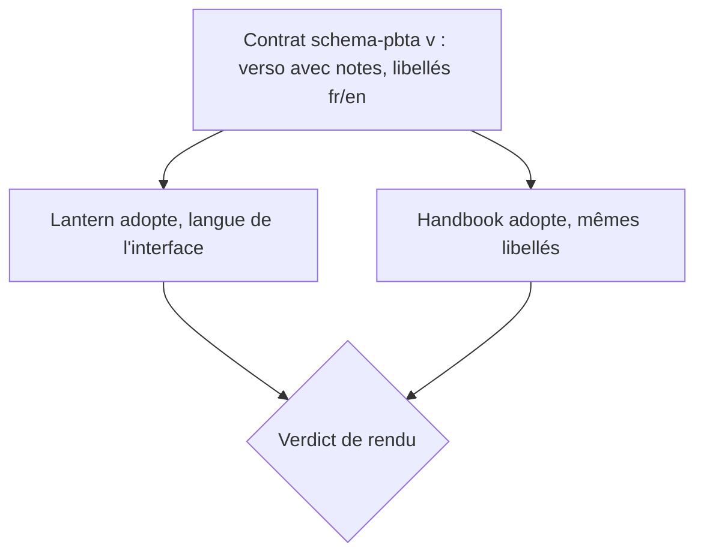
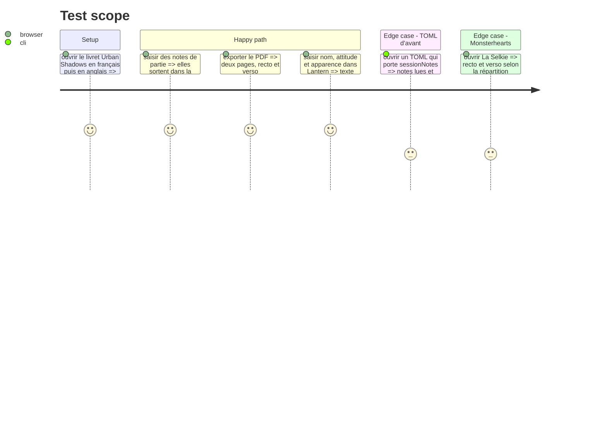

# Instruction: Verso, en-tête éditable et langue des livrets Monsterhearts et Urban Shadows

## Architecture projection

```txt
../schema-pbta/
├── src/presentation/playbook-pages.ts ✏️ plus de page de notes séparée pour ces deux jeux (modèle schema-adrenaline v7, bb898b9)
├── src/presentation/urban-shadows-playbook.ts ✏️ libellés { fr, en }, région des notes dans le verso
├── src/presentation/monsterhearts-playbook.ts ✏️ idem
├── examples/urban-shadows/urban-shadows-playbook/ ✏️ exemple français à côté de l'anglais
└── corpus/ ✏️ témoins et refus
src/locales/fr.ts ✏️ retrait des libellés de région que le contrat publie
```

```txt
../lantern/
├── src/templates/urban-shadows/playbook/{model.ts,sample.ts} ✏️ modèle vierge et exemple en français et en anglais
├── src/templates/urban-shadows/playbook/preview/UrbanShadowsPlaybookPreview.tsx ✏️ lignes d'en-tête = champs saisis
├── src/templates/urban-shadows/playbook/editor/UrbanShadowsPlaybookEditorPanel.tsx ✏️ champs d'en-tête, zone Notes de partie
├── src/templates/monsterhearts/playbook/ ✏️ verso, notes, en-tête si une ligne l'attend
└── src/i18n/locales/{fr,en}/pbta.ts ✏️ retrait des libellés de région que le contrat publie
```

Verso, export par pages : lus depuis `pages` du contrat, rien de codé en dur dans Lantern ni dans Handbook.

## User Journey



## Test Scope



## Tasks to do

### `0)` Constats avant d'écrire

1. Lire `bb898b9` (schema-adrenaline) en entier : comment les notes passent dans le verso, comment `notesPath` disparaît, ce que devient un ancien TOML. Reprendre ce comportement, pas le deviner.
2. Monsterhearts n'a pas de faces : sa pagination est une page `sheet` unique (groupes `identity`, `playbook`, `relationships`, `state`, `editorial`) puis les notes. Ouvrir le PDF d'origine de La Selkie : a-t-il un verso, et quelles lignes d'identité y sont à remplir (nom de la mue, etc.) ? Répartir alors les groupes en `recto` / `verso` (ce qui est au verso dans le PDF, sinon : identité, actions et équipement au recto ; relations, état, textes éditoriaux et notes au verso) et inscrire la répartition au tableau Decisions du plan ; elle est soumise au verdict de la phase 6.
3. Trancher mineure ou majeure : la page de notes séparée et `notes_field` disparaissent de la pagination de ces deux jeux (cassant pour qui lit `pages`) ; les champs d'en-tête sont un ajout facultatif. Inscrire le choix au tableau Decisions du plan. Le champ de données `sessionNotes` reste (un ancien TOML garde ses notes) : seul son emplacement dans la mise en page change.

### `1)` Contrat schema-pbta

1. Appliquer le patron de `bb898b9` : région « Notes de partie » dans le verso (champ `sessionNotes`), pages `recto` et `verso` seulement pour Urban Shadows et Monsterhearts (répartition du constat 2). Les cibles `masks-playbook`, `the-sprawl-playbook` et `playbook` partagent `NOTES_PAGE` : décider explicitement de les migrer avec ou de leur garder la page de notes, et le dire au Decisions (un changement de pagination silencieux casserait leurs consommateurs).
2. Champs facultatifs de l'en-tête écrits par le joueur, sur le modèle de `characterName` de The Sprawl : nom et pronoms, attitude (`demeanor`), apparence (`look`) pour Urban Shadows ; le nom pour Monsterhearts seulement si le PDF de La Selkie (constat 2) porte une ligne à remplir qui l'attend ; sinon, ne rien ajouter. Ajout facultatif, donc compatible.
3. Libellés de région `{ fr, en }` (`label` de chaque région d'Urban Shadows et de Monsterhearts, création et verso compris) ; exemple français à côté de l'anglais (`the-aware`) ; témoins et refus du corpus (refus : page de notes résiduelle, libellé sans `en`, région du verso sans `group`).
4. `npm run check` de schema-pbta (restaurer les fichiers réécrits en LF dont `git diff --ignore-cr-at-eol` est vide) ; recopier `playbook.css` si la phase 2 l'a modifié : une seule version fournisseur pour les phases 2 et 4.

### `2)` Consommateurs

0. Les consommateurs adoptent le paquet par l'épingle de producteur (`package.json`), jamais par un numéro recopié ; tant que le fournisseur n'est pas publié, travailler contre une version candidate (rc), comme le fait le superviseur.
1. Lantern : champs de l'en-tête modifiables dans l'éditeur (la ligne à remplir devient le texte saisi, vide = ligne à remplir, comme sur la fiche papier) ; lire les libellés du contrat selon la langue de l'interface ; verso et export par pages. Le modèle vierge (`urban-shadows/playbook/model.ts`) et l'exemple (`sample.ts`) portent des textes anglais en dur : les fournir en français et en anglais selon la langue de l'interface, jamais mêlés dans une même fiche.
1 bis. Décidé en cours de phase (demande de l'utilisateur, l'illustration cassait la mise en page) : `playbookImage` n'est plus un champ du bloc d'identité mais la région `urban-shadows-illustration` (primitive `portrait`), d'abord au recto sous « Identité », puis **déplacée au verso** à la demande de l'utilisateur (« mettre l'illustration sur ce verso ») : 1re colonne de la rangée du verso, avec l'équipement ; les notes de partie occupent la 2e. Lantern dessine désormais une fiche par face (étiquette Recto / Verso, comme Monsterhearts et la PJ Adrenaline) ; le bloc « Création du personnage », qui n'est qu'une aide à l'édition (Handbook ne l'imprime pas), n'est plus dessiné sur la fiche (demande de l'utilisateur : « on ne met que le résultat dans la fiche, pas les outils de construction du personnage ») : le moteur de rendu `urban-shadows-creation` ne rend rien, et l'éditeur de création s'ouvre depuis le panneau par le bouton « Questions de création (non imprimées) » (clé `pbta.urbanShadows.editor.openCreation`), présent dans l'état vide et au bas de chaque éditeur de région. Lantern dessine toujours l'illustration (repère « Illustration à ajouter » si l'adresse est vide, pour que le clic ouvre le champ) ; Handbook ne la dessine que si une image est résolue. Fond de page écarté : illisible et mauvais à l'impression.

1 ter. Décidé en cours de phase (demande de l'utilisateur : « le verso doit être replié par défaut, et dépliable si besoin », puis « oui pour toutes les fiches de personnage ») : dans Lantern, le verso de chaque fiche de personnage PbtA (Urban Shadows, Monsterhearts, Masks, The Sprawl) et chaque page de notes (`NotesPage`, partagée avec Otherscape) est enveloppé dans `FoldablePage` : une poignée « Verso » (clé `pbta.sheet.verso`) le déplie. Replié, la page garde sa taille réelle (enveloppe de hauteur 0 + `inert`, pas de `<details>` fermé) parce que les exports PNG/PDF mesurent le nœud `data-export-page` ; sous `@media print` le verso est déplié. La PJ Adrenaline est laissée telle quelle : son verso (`identite`) est déjà une section repliée.
2. Handbook : même lecture ; supprimer de `src/locales/fr.ts` les libellés de région que le contrat publie, garder ceux que Handbook est seul à porter ; le bloc `pbta-playbook` lit les champs d'en-tête et la région des notes du verso ; l'impression (`_print.scss`, une face par page) suit les pages du contrat.

## Test acceptance criteria

| Task | Acceptance criteria |
| ---- | -------------------- |
| 0 | Le plan porte, au tableau Decisions, la répartition recto / verso de Monsterhearts, le choix mineure / majeure et le sort de Masks, The Sprawl et du livret générique. |
| 1 | `npm run check` de schema-pbta vert ; le corpus passe, refus compris ; aucune page de notes séparée pour Urban Shadows et Monsterhearts ; chaque libellé de région existe en `fr` et `en` ; nom, `demeanor` et `look` sont facultatifs et exportés dans le TOML. |
| 2 | `pnpm check` (Lantern) vert ; `rtk proxy pnpm build` et les deux portées de lint (Handbook) verts ; Handbook et Lantern affichent les mêmes libellés dans la même langue, sans mélange français / anglais dans une fiche ; l'en-tête se saisit dans Lantern et se relit dans Handbook ; le verso porte les notes et s'exporte en deux pages ; un ancien TOML avec `sessionNotes` reste lisible. |
