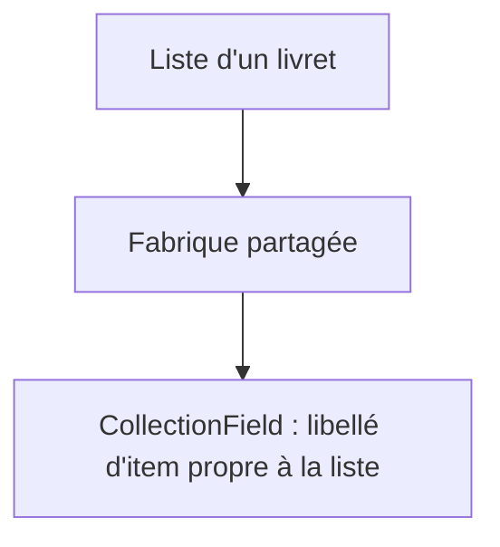
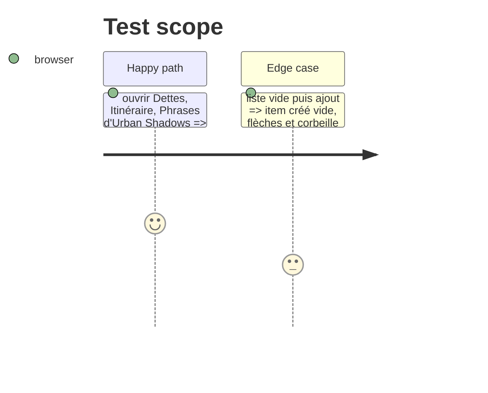

# Instruction: Lantern, factoriser les éditeurs de liste des livrets

## Architecture projection

Dépôt : `../lantern`. Phase indépendante des autres : aucune version fournisseur à attendre.

```txt
src/templates/pbta/specialized/descriptorFactories.ts ✅ scalar, object, list, strings, records (une seule copie)
src/templates/urban-shadows/playbook/editor/UrbanShadowsPlaybookEditorPanel.tsx ✏️ utilise la fabrique
src/templates/monsterhearts/playbook/editor/MonsterheartsPlaybookEditorPanel.tsx ✏️ idem
src/templates/the-sprawl/playbook/editor/SprawlPlaybookEditorPanel.tsx ✏️ idem pour ce qui est commun
src/i18n/locales/{fr,en}/pbta.ts ✏️ libellé d'item par liste
```

## User Journey



## Test Scope



## Tasks to do

### `1)` Extraire

1. Comparer les trois copies (Urban Shadows et Monsterhearts identiques, The Sprawl en variante), nommer les différences de la variante, puis déplacer dans un module partagé ce qui est commun ; chaque différence devient un paramètre de la fabrique ou une surcharge locale justifiée dans le code. Les trois panneaux importent le module.
2. Libellé d'item passé à la fabrique, pas le générique « Élément ».

> Fait : `createDescriptorFactories({ name, itemName })` ; libellés dans `pbta:<jeu>.itemNames.<liste>` (fr et en). The Sprawl ne duplique que `scalar` (ses listes passent par `labelled`, propre à ses régions) : il n'importe que `scalar` du module, `labelled` reste local.

### `2)` Prouver

1. `pnpm check` de Lantern vert (typecheck et lint inclus) ; le rendu des listes ne change que par le libellé d'item : ouvrir à la main une liste de chaque jeu (ajouter, monter, descendre, supprimer).

## Test acceptance criteria

| Task | Acceptance criteria |
| ---- | -------------------- |
| 1 | Une seule définition de `list`, `strings`, `records` ; aucune copie dans les panneaux. |
| 2 | Les listes d'Urban Shadows, Monsterhearts et The Sprawl se comportent comme avant, avec des libellés d'item propres, en français et en anglais. |
