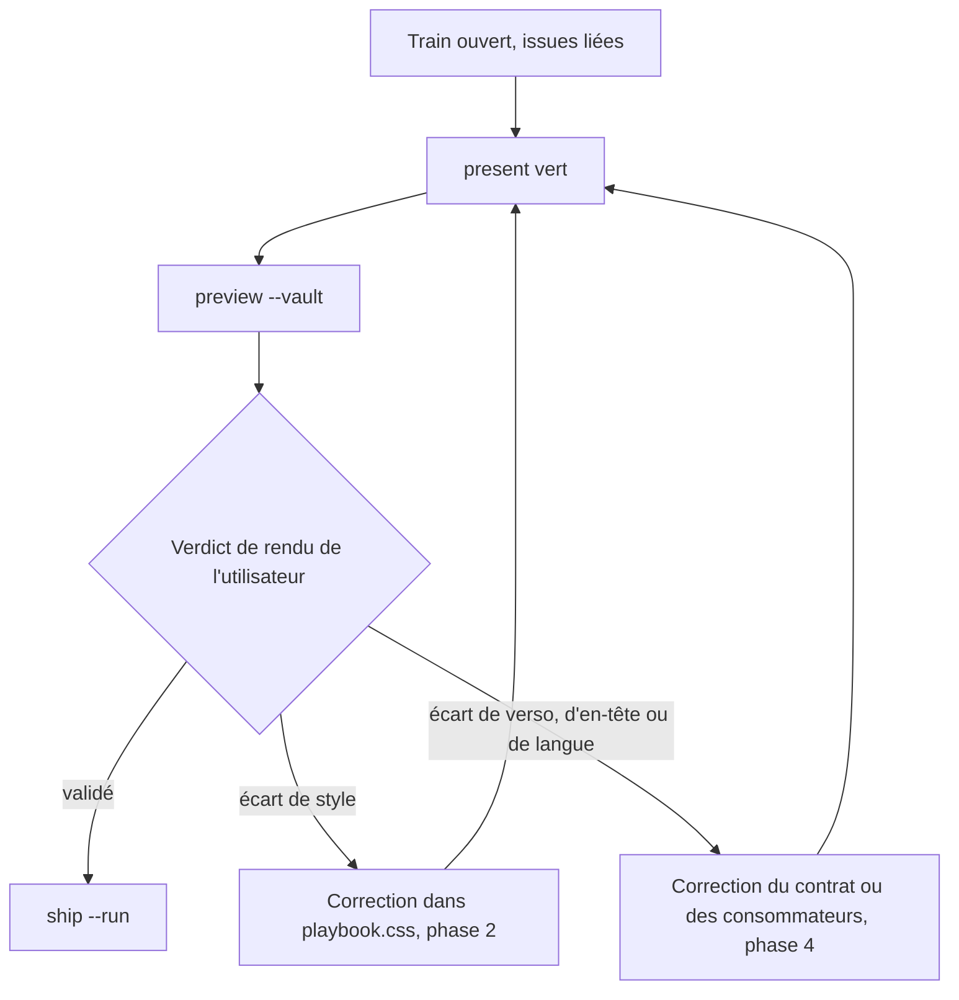

# Instruction: Présenter, valider le rendu et livrer

## Architecture projection

```txt
supervisor/trains/pbta-playbook-render-fixes.json ✅ tenu par le superviseur jusqu'à `close`
aidd_docs/tasks/2026_11/2026_11_09_pbta-playbook-shared-styles/reference.md ✏️ verdict final inscrit
```

## User Journey



## Test Scope

```mermaid
---
title: Test scope
---
journey
  section Setup
    ouvrir le train et lier les dépôts concernés => next liste les items: 5: cli
  section Happy path
    pnpm supervise present => validations vertes: 5: cli
    pnpm supervise ship --run après le verdict => versions publiées, issues #131 et #132 closes: 5: cli
  section Edge case - issue de coordination
    supervise open crée une issue neuve alors que #131 existe => clore #131 et #132 avec renvoi: 3: cli
```

## Tasks to do

### `1)` Ouvrir le train

> Une seule issue de coordination.

0. Items du train : schema-pbta (CSS et contrat), Lantern, Handbook. Lantern et Handbook dépendent de schema-pbta.
1. Vérifier d'abord, dans `doc/supervisor.fr.md` et par `pnpm supervise open --help`, si `open` accepte une issue de coordination existante : si oui, rattacher le train à #131 ; sinon `pnpm supervise open pbta-playbook-render-fixes`, puis proposer à l'utilisateur de clore #131 et #132 avec un renvoi vers l'issue neuve (geste visible des tiers, à confirmer).
2. Lier une issue par dépôt concerné : schema-pbta (CSS et contrat), Lantern (adoption, éditeurs, factorisation de la phase 5), Handbook (adoption, libellés, impression). Les issues des consommateurs suivent l'ordre fournisseur puis consommateurs de la topologie.

### `2)` Présenter puis valider

> Tout se contrôle dans `present` ; seul le verdict de rendu est demandé.

1. Messages de commit en anglais, terminés par `Closes #N`, puis `pnpm supervise commit` et `present`.
2. `pnpm supervise preview --vault <coffre de test>` pour Handbook, et Lantern lancé en local (`http://localhost:5183/`, à laisser tourner) pour Lantern ; l'utilisateur donne son verdict sur les six points de contrôle, les polices (écarts 2 et 9), le verso, l'en-tête éditable, la langue des deux jeux et l'export PDF de La Selkie.
3. Un écart renvoie à la phase 2 (style) ou 4 (verso, en-tête, langue), puis `present` à nouveau ; au plus deux cycles, ensuite retour à l'utilisateur.

### `3)` Livrer

1. `pnpm supervise ship --run`.
2. Inscrire le verdict dans `reference.md` et les pièges rencontrés dans la mémoire du projet (fichier de reprise du train, lié à l'index).
3. Passer `status` du plan à `done` seulement quand #131 et #132 sont closes et le verdict inscrit.

## Test acceptance criteria

| Task | Acceptance criteria |
| ---- | -------------------- |
| 1 | `pnpm supervise next` montre les items du train ; il n'existe qu'une issue de coordination ouverte. |
| 2 | `present` est vert, et l'utilisateur a validé les points de contrôle de chaque jeu dans les deux outils, les polices, le verso, l'en-tête, la langue et l'export PDF. |
| 3 | La nouvelle version de chaque dépôt modifié est publiée, #131 et #132 sont closes, `reference.md` porte le verdict. |
